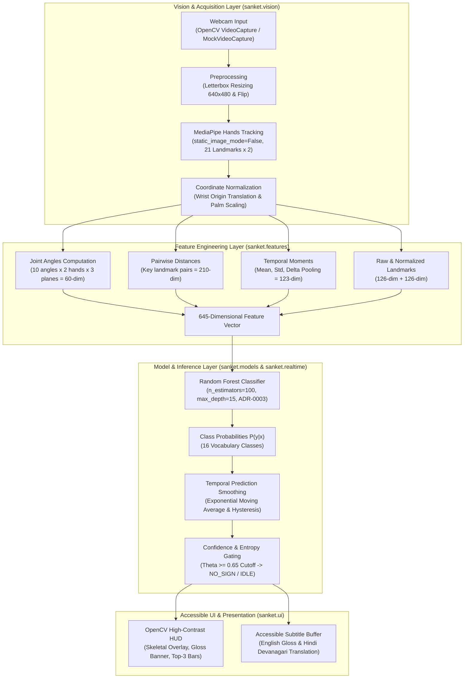
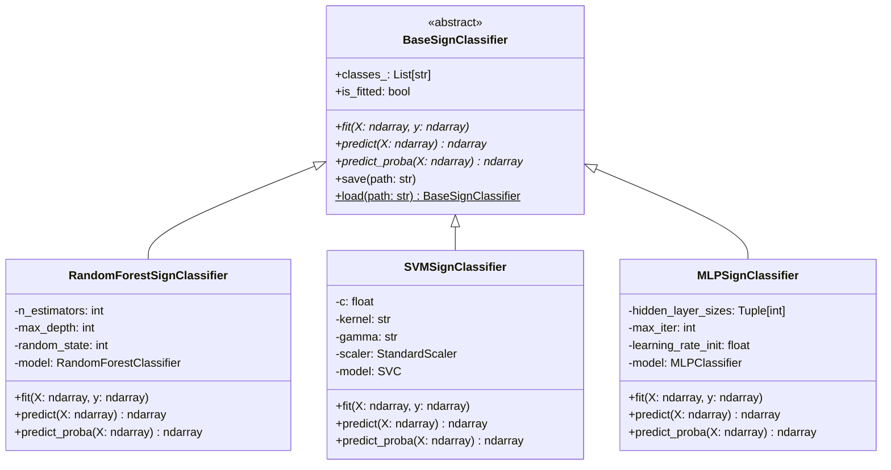

# SANKET (संकेत) — System Architecture

> **Comprehensive Technical Architecture Specification**  
> *Layered design, module boundaries, data-flow pipelines, and interface contracts.*

---

## 1. Architectural Philosophy & Design Principles

SANKET is engineered around five fundamental architectural tenets:
1. **Edge-First & Offline Computation**: Complete execution on commodity multi-core CPUs without network dependencies or proprietary GPU accelerators.
2. **Strict Layer Decoupling**: Unidirectional dependency flow (`core` $\rightarrow$ `data` $\rightarrow$ `vision` $\rightarrow$ `features` $\rightarrow$ `models` $\rightarrow$ `evaluation` $\rightarrow$ `realtime` $\rightarrow$ `ui`). No cyclical dependencies permitted.
3. **Reproducibility & Seed Locking**: Deterministic model evaluation, explicit pseudo-random seed locking (`seed=42`), and JSON manifest provenance.
4. **Zero-Retention Privacy**: Ephemeral in-memory frame processing. Biometric media is strictly forbidden from persistent disk storage.
5. **Contract-Driven Polymorphism**: All classifiers implement an explicit abstract base class (`BaseSignClassifier`) guaranteeing uniform serialization, prediction, probability calculation, and evaluation.

---

## 2. End-to-End System Pipeline

The following flowchart illustrates the complete lifecycle of visual sign recognition from photon capture to accessible user feedback:



---

## 3. Subsystem Breakdown & Directory Mapping

```text
src/sanket/
├── core/                  # System configuration and foundation utilities
│   ├── config.py          # Pydantic schemas (SanketConfig, CameraConfig, etc.)
│   └── __init__.py
├── data/                  # Dataset ingestion and split management
│   ├── ingestion.py       # Checksum validation and archive extraction
│   ├── inspection.py      # Class distribution, signer balance, metadata checks
│   ├── splits.py          # Signer-Independent train/val/test splitting
│   └── __init__.py
├── vision/                # Video processing and landmark extraction
│   ├── capture.py         # Threaded camera capture and CI mock video playback
│   ├── preprocessing.py   # Letterbox resizing, aspect ratio preservation, flipping
│   ├── landmarks.py       # MediaPipe Hands 21-point skeletal extraction
│   ├── pose.py            # MediaPipe Pose upper-body anchor investigation
│   ├── normalization.py   # Wrist-centering and palm-scale coordinate normalization
│   └── __init__.py
├── features/              # Feature vector generation
│   ├── geometry.py        # Joint angle trigonometry and Euclidean distance matrices
│   ├── temporal.py        # Sliding-window statistical pooling and moment features
│   ├── extractor.py       # Composite 645-dim feature vector generator
│   └── __init__.py
├── models/                # Machine learning architectures
│   ├── base.py            # Abstract BaseSignClassifier contract
│   ├── random_forest.py   # RandomForestSignClassifier (ADR-0003 baseline)
│   ├── svm.py             # SVMSignClassifier (RBF kernel, StandardScaler)
│   ├── mlp.py             # MLPSignClassifier (Adam optimizer, ReLU)
│   └── __init__.py
├── evaluation/            # Evaluation harness and metrics
│   ├── metrics.py         # Top-1, Top-5, Macro P/R/F1, MCC computation
│   ├── latency.py         # Per-sample CPU latency (p50, p90, p95, p99, FPS)
│   ├── manifest.py        # Standardized JSON evaluation report schema
│   ├── evaluator.py       # ModelEvaluator unified benchmark runner
│   ├── diagnostics.py     # Confusion matrix and phonological error breakdown
│   └── __init__.py
├── realtime/              # Real-time streaming runtime
│   ├── engine.py          # Asynchronous threaded model dispatcher
│   ├── smoothing.py       # Probability EMA and Schmitt-trigger hysteresis
│   ├── thresholding.py    # Out-of-vocabulary gating and resting hand detection
│   └── pipeline.py        # End-to-end camera-to-sign pipeline coordinator
└── ui/                    # Visual overlay and accessible transcript presentation
    ├── overlay.py         # Skeletal bone rendering, confidence meters, latency HUD
    └── text_display.py    # Subtitle history, English/Hindi gloss translations
```

---

## 4. Class & Interface Hierarchy

All model implementations adhere to the object-oriented contract defined in `sanket.models.base`:



---

## 5. Formal Data Contracts & Feature Topology

The feature engineering layer (`sanket.features.extractor.FeatureExtractor`) maps raw frame landmark detections into a fixed **645-dimensional feature vector**:

$$\mathbf{x}_{\text{feat}} = [\mathbf{x}_{\text{raw}}, \mathbf{x}_{\text{norm}}, \mathbf{x}_{\text{angles}}, \mathbf{x}_{\text{dist}}, \mathbf{x}_{\text{temp}}] \in \mathbb{R}^{645}$$

| Component | Dimensions | Mathematical Derivation |
| :--- | :---: | :--- |
| **Raw Coordinates** ($\mathbf{x}_{\text{raw}}$) | $126$ | 2 hands $\times$ 21 landmarks $\times$ 3 coordinates ($x, y, z$). |
| **Normalized Coordinates** ($\mathbf{x}_{\text{norm}}$) | $126$ | Wrist translation $\mathbf{p}'_i = \mathbf{p}_i - \mathbf{p}_{\text{wrist}}$ scaled by palm size $s = \|\mathbf{p}_{\text{mcp}} - \mathbf{p}_{\text{wrist}}\|_2$. |
| **Joint Angles** ($\mathbf{x}_{\text{angles}}$) | $60$ | Inter-finger 3D angles: $\theta = \arccos\left(\frac{\mathbf{u} \cdot \mathbf{v}}{\|\mathbf{u}\|_2 \|\mathbf{v}\|_2}\right)$ across 10 finger joints $\times$ 2 hands $\times$ 3 projection planes. |
| **Pairwise Distances** ($\mathbf{x}_{\text{dist}}$) | $210$ | Euclidean distances $d_{ij} = \|\mathbf{p}_i - \mathbf{p}_j\|_2$ between fingertips, MCP joints, and wrist anchors. |
| **Temporal Moments** ($\mathbf{x}_{\text{temp}}$) | $123$ | Mean, standard deviation, and finite difference velocity: $\mathbf{v}_t = \frac{\mathbf{p}_t - \mathbf{p}_{t-1}}{\Delta t}$ over sliding window $W$. |

---

## 6. Latency & Resource Budgets

To achieve a seamless real-time user experience at $\ge 20$ FPS, the end-to-end execution budget is strictly capped at **$100\text{ ms}$**:

```text
[Camera Capture]  ===> [Preprocessing] ===> [MediaPipe Tracking] ===> [Feature Extraction] ===> [Model Inference] ===> [Smoothing & UI]
   (0 - 5 ms)             (1 - 3 ms)              (10 - 15 ms)              (2 - 4 ms)               (0.5 - 1.0 ms)           (1 - 2 ms)
+------------------------------------------------------------------------------------------------------------------------------------+
|  Total Cumulative CPU Budget: < 30 ms (Comfortably satisfies < 100 ms target, allowing > 30 FPS continuous processing)              |
+------------------------------------------------------------------------------------------------------------------------------------+
```

