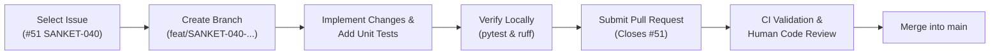

# SANKET (संकेत) — Developer Onboarding & Development Workflow

> **Authoritative Engineering Guide for Setting Up, Developing, and Contributing to SANKET**  
> *Follow these standardized practices to ensure reproducibility, code quality, and privacy compliance.*

---

## 1. Local Environment Setup

### Prerequisites
- Python 3.10, 3.11, or 3.12 installed on your system.
- Git (configured with your author name and email).
- GitHub CLI (`gh`) authenticated with repository access.

### Step 1: Clone Repository
```bash
git clone https://github.com/GITLUVV/Sanket.git
cd Sanket
```

### Step 2: Create and Activate Virtual Environment
```bash
# On Linux / macOS:
python3 -m venv venv
source venv/bin/activate

# On Windows (PowerShell):
python -m venv venv
.\venv\Scripts\Activate.ps1

# On Windows (Command Prompt):
python -m venv venv
venv\Scripts\activate.bat
```

### Step 3: Install in Editable Mode with Development Dependencies
```bash
python -m pip install --upgrade pip
pip install -e ".[dev]"
```

### Step 4: Verify Environment Integrity
Run the built-in diagnostic setup verification script:
```bash
python scripts/verify_setup.py
```
Expected output:
```text
[PASS] Python version check (3.12.x >= 3.10)
[PASS] Core dependencies check (numpy, pydantic, pyyaml, cv2, mediapipe, sklearn, joblib)
[PASS] Internal module import check (sanket.core, sanket.data, sanket.vision, sanket.features, sanket.models, sanket.evaluation)
[PASS] Configuration file check (configs/default.yaml)
All 4 environment checks passed successfully!
```

---

## 2. Daily Engineering Workflow

### Running Unit & Integration Tests
Execute the comprehensive Pytest suite:
```bash
# Run all unit tests quietly:
pytest -q

# Run with verbose output and test names:
pytest -v

# Run with code coverage reporting:
pytest --cov=sanket tests/
```

### Code Style, Formatting & Linting
Sanket enforces strict static analysis via Ruff and Black:
```bash
# Check code style and linting:
ruff check .

# Automatically apply safe fixes:
ruff check --fix .

# Check formatting compliance:
black --check src tests scripts
```

---

## 3. Git Branching & Issue-Driven Development

SANKET follows a strict **Issue $\rightarrow$ Branch $\rightarrow$ Pull Request** workflow:



### Standard Branch Naming Conventions
Use issue-traceable branch names:
- `feat/SANKET-XXX-short-description` — New features or pipeline additions
- `fix/SANKET-XXX-short-description` — Bug fixes or defect resolutions
- `research/SANKET-XXX-short-description` — Feasibility investigations, dataset analysis, error diagnostics
- `docs/SANKET-XXX-short-description` — Documentation, ADRs, logs, or Wiki updates
- `test/SANKET-XXX-short-description` — Test harness additions, synthetic benchmarks
- `security/SANKET-XXX-short-description` — Security hardening and vulnerability resolutions
- `refactor/SANKET-XXX-short-description` — Internal restructuring with identical behavior

### Branch Creation Example
```bash
git checkout main
git pull origin main
git checkout -b feat/SANKET-040-webcam-capture-pipeline
```

---

## 4. Pull Request Requirements & Governance

Every Pull Request must pass automated validation (`.github/workflows/pr-metadata.yml`):

1. **Conventional Commits Title**:  
   `feat(scope): brief description (SANKET-XXX)` or `fix(scope): brief description (Closes #XX)`
2. **Milestone Assigned**:  
   Must be attached to the active milestone (e.g., `Milestone 2 — Real-Time Sanket MVP`).
3. **Four-Dimensional Labels**:  
   Must have at least one label from each required category:
   - `type:*` (`type:feature`, `type:bug`, `type:research`, etc.)
   - `area:*` (`area:vision`, `area:ml`, `area:ui`, `area:testing`, etc.)
   - `priority:*` (`priority:P0`, `priority:P1`, `priority:P2`, `priority:P3`)
   - `phase:*` (`phase:1`, `phase:2`, etc.)
4. **Closing Issue Reference**:  
   Must include an explicit reference in the body: `Closes #51`.
5. **Testing Evidence**:  
   Must include verifiable test command execution proof and acceptance criteria checkboxes.

---

## 5. Local Privacy & Path Sanity Policy

> [!CAUTION]
> **Strict Non-Negotiable Rule**:
> - Never include absolute personal paths (e.g., `C:\Users\...` or machine-specific usernames) in commits, PR descriptions, issue bodies, or documentation.
> - Always use repository-relative paths (e.g., `src/sanket/vision/capture.py` or `docs/experiments/README.md`).
> - Never commit raw camera videos, images of human faces, or biometric media.

