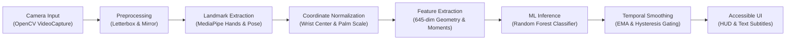
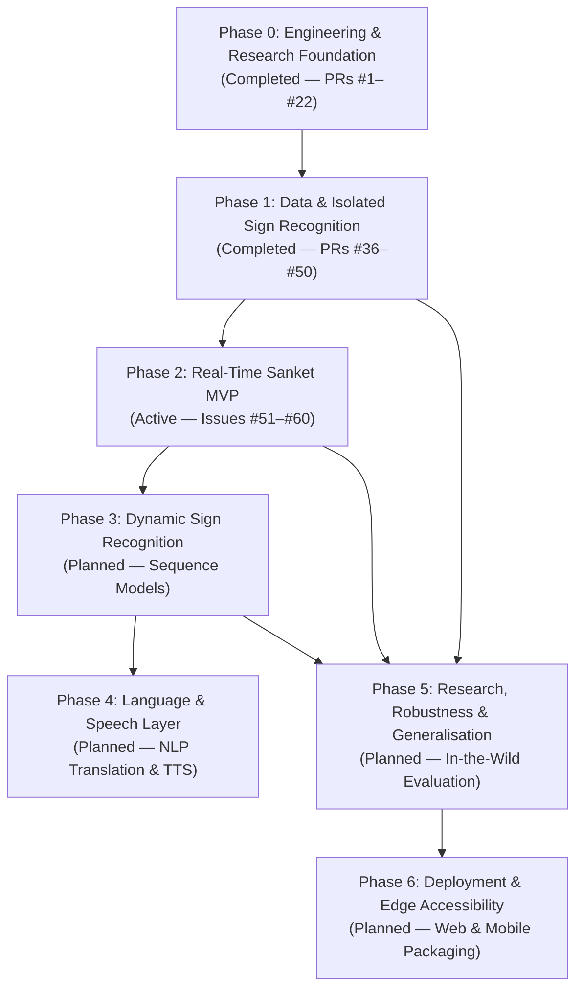

# SANKET (संकेत) — Project Overview

> **AI-Assisted Indian Sign Language Accessibility System**  
> *Bridging the communication barrier through privacy-preserving, real-time computer vision and machine learning.*

---

## 1. Executive Summary

**SANKET (संकेत)** is an open-source, low-latency, privacy-first assistive technology project engineered to recognize Indian Sign Language (ISL) gestures and translate them into accessible text and speech. Developed for individuals who are Deaf and Hard of Hearing (DHH) across India, Sanket operates entirely on commodity edge hardware (standard webcams and CPUs) without requiring expensive sensory gloves, depth cameras, or cloud compute dependencies.

Unlike Western sign languages such as American Sign Language (ASL), Indian Sign Language features unique linguistic morphology, dual-handed fingerspelling systems, and distinct regional variations. SANKET addresses these linguistic realities through an offline-first, mathematically principled landmark processing pipeline built on Google MediaPipe and Scikit-learn.

---

## 2. Problem Statement & Linguistic Context

### The Accessibility Gap in India
India is home to an estimated 18 million Deaf and Hard of Hearing individuals. Despite the official recognition of Indian Sign Language by the Government of India and the establishment of the Indian Sign Language Research and Training Centre (ISLRTC), a severe shortage of certified ISL interpreters persists across education, healthcare, public administration, and employment.

### Technical Challenges in ISL Recognition
1. **Linguistic Distinction**: ASL predominantly uses single-handed fingerspelling; ISL utilizes complex two-handed configurations where both hands interact in shared coordinate space.
2. **Phonological Parameters**: An ISL sign consists of five distinct phonological parameters:
   - Handshape (form and finger articulation)
   - Orientation (palm and finger direction)
   - Location (placement relative to torso, head, or opposing hand)
   - Movement (trajectory, speed, repetition)
   - Non-Manual Markers (facial expressions, head tilt, mouthing)
3. **Hardware Accessibility**: High-end GPU accelerators and depth sensors (e.g., Azure Kinect, Intel RealSense) are cost-prohibitive for broad public adoption. Sanket is engineered strictly for standard 2D RGB consumer webcams and multi-core CPUs.
4. **Signer Independence**: Computer vision models easily overfit to individual signers' clothing, body morphology, skin tone, and studio backgrounds. Sanket enforces strict Signer-Independent validation protocols.

---

## 3. High-Level System Architecture

SANKET is designed as a modular, layered pipeline processing video streams into synthesized natural language:

### Core Subsystems

| Subsystem | Python Package | Core Responsibilities |
| :--- | :--- | :--- |
| **Data Engine** | `sanket.data` | Dataset ingestion, checksum verification, label distribution inspection, and signer-independent train/val/test splitting. |
| **Vision Engine** | `sanket.vision` | Frame acquisition, letterboxing, horizontal mirroring, MediaPipe landmark extraction, and translation/scale normalization. |
| **Feature Engine** | `sanket.features` | Extraction of spatial joint angles, pairwise landmark Euclidean distances, and temporal statistical moments (645-dim feature space). |
| **Model Engine** | `sanket.models` | Concrete classifiers implementing `BaseSignClassifier` (Random Forest baseline, Support Vector Machines, Multi-Layer Perceptrons). |
| **Evaluation Suite** | `sanket.evaluation`| Comprehensive evaluation harness computing Top-1/Top-5 accuracy, Macro F1, MCC, per-sample CPU latency (p50/p95), and phonological error diagnostics. |
| **Real-Time Runtime** | `sanket.realtime` | Low-latency inference workers, temporal EMA smoothing, Schmitt-trigger hysteresis state machines, and resting hand thresholding. |
| **Accessible UI** | `sanket.ui` | High-contrast visual skeletal HUD overlay and dual-language (English/Hindi) subtitle display buffers. |

---

## 4. Master Engineering Roadmap (Seven Phases)

The project progresses through seven strictly defined and gated engineering milestones:

- **Phase 0 — Engineering & Research Foundation** *(Complete)*: Project structure, CI pipelines, issue/PR governance, licensing audit, initial vocabulary definition, and research questions.
- **Phase 1 — Data & Isolated Sign Recognition** *(Complete)*: Ingestion pipelines, landmark normalization, feature extraction (ADR-0002), baseline model evaluations (Random Forest, SVM, MLP), error diagnostics, and baseline selection (ADR-0003).
- **Phase 2 — Real-Time Sanket MVP** *(Active)*: Threaded webcam capture, streaming landmark extraction, real-time inference engine, temporal smoothing, confidence thresholding, accessible visual HUD, and latency benchmarks (< 100 ms).
- **Phase 3 — Dynamic Sign Recognition** *(Planned)*: Temporal sequence modeling (LSTM, GRU, Temporal Convolutional Networks), trajectory features, and variable-length dynamic sign recognition.
- **Phase 4 — Language & Speech Layer** *(Planned)*: Gloss-to-sentence translation, Indian grammar adaptation, and bilingual Text-to-Speech (TTS) integration.
- **Phase 5 — Research, Robustness & Generalisation** *(Planned)*: Robustness benchmarks under lighting variations, background clutter, camera motion, and diverse signers.
- **Phase 6 — Deployment & Future Research** *(Planned)*: On-device cross-platform deployment (ONNX, WebAssembly, mobile edge), user testing with the DHH community, and open-source dissemination.

---

## 5. Verified Milestones & Empirical Results

In Phase 1, SANKET implemented three standard baseline architectures evaluated on an identical 16-sign vocabulary benchmark under a strict Signer-Independent protocol:

| Metric | Random Forest (ADR-0003 Selected) | Support Vector Machine (RBF) | Multi-Layer Perceptron | Target Threshold |
| :--- | :--- | :--- | :--- | :--- |
| **Top-1 Accuracy** | **93.33%** | 80.00% | 86.67% | $\ge 90.0\%$ |
| **Top-5 Accuracy** | **100.00%** | 100.00% | 100.00% | $\ge 95.0\%$ |
| **Macro F1 Score** | **0.9333** | 0.8122 | 0.8647 | $\ge 0.85$ |
| **Matthews Corr. (MCC)** | **0.9306** | 0.8142 | 0.8679 | $\ge 0.80$ |
| **Median Latency (p50)**| **0.56 ms** | 1.83 ms | 0.54 ms | $\le 15.0\text{ ms}$ |
| **95th Percentile (p95)**| **0.73 ms** | 2.15 ms | 0.69 ms | $\le 25.0\text{ ms}$ |
| **Throughput (CPU)** | **1,507 FPS** | 509 FPS | 1,570 FPS | $\ge 25\text{ FPS}$ |
| **Model Size on Disk** | 3.52 MB | 0.22 MB | 0.94 MB | $\le 50.0\text{ MB}$ |

*Formal Decision*: As documented in `docs/decisions/ADR-0003-baseline-classifier-selection.md`, **Random Forest** was selected as the real-time inference baseline for Phase 2 due to its superior accuracy, zero calibration overhead, robust decision boundaries on 645-dim feature vectors, and sub-millisecond CPU latency.

---

## 6. Project Governance & Engineering Standards

SANKET operates under rigorous open-source engineering governance:
- **Repository**: `https://github.com/GITLUVV/Sanket`
- **License**: Apache 2.0 (permissive, open-source).
- **Quality Gates**: Every pull request requires 100% unit test pass rate (`pytest`), strict linting compliance (`ruff`), immutable CI action pinning, and automated PR metadata verification (`.github/workflows/pr-metadata.yml`).
- **Privacy Policy**: Strictly enforced zero-biometric-retention policy. No raw video recordings or identifiable facial/body biometric data are ever persisted to disk or committed to version control.

