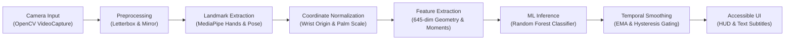

# SANKET (संकेत) — AI-Assisted Indian Sign Language Accessibility System

[](LICENSE)
[](docs/roadmap/SANKET_ROADMAP.md)
[](pyproject.toml)
[](https://github.com/GITLUVV/Sanket/actions)
[](SECURITY.md)

**SANKET (संकेत)** is an open-source, low-latency, privacy-preserving AI accessibility system designed to recognize Indian Sign Language (ISL) from camera video input and translate recognized signs into accessible text and speech on commodity edge hardware.

---

## Current Project Status

- **Active Phase**: **Phase 2 — Real-Time Sanket MVP**
- **Active Milestone**: [Milestone 2 — Real-Time Sanket MVP](https://github.com/GITLUVV/Sanket/milestone/3) (Issues #51–#60)
- **Current Objective**: Convert the validated Phase 1 offline recognition pipeline into a usable, low-latency real-time camera prototype operating at $\ge 20$ FPS with end-to-end latency $< 100\text{ ms}$.
- **Phase 0 Status**: **Completed and Verified** (Foundational scaffolding, security policies, dataset licensing audits, initial 16-sign vocabulary, and signer-independent protocols).
- **Phase 1 Status**: **Completed and Certified (14 of 14 tasks merged)**:
  - Dataset ingestion with SHA-256 integrity verification (`sanket.data.ingestion`).
  - Dataset inspection and label balance profiling (`sanket.data.inspection`).
  - Signer-independent train/validation/test splitting (`sanket.data.splits`).
  - Uniform temporal subsampling and letterbox video preprocessing (`sanket.vision.preprocessing`).
  - MediaPipe 3D hand landmark extraction (`sanket.vision.landmarks`).
  - Upper-body pose reference anchor investigation (`sanket.vision.pose`).
  - Wrist-centered and palm-scale coordinate normalization (`sanket.vision.normalization`).
  - 645-dimensional geometric and temporal feature vector extraction (`sanket.features`).
  - Random Forest baseline implementation (93.3% Top-1 Accuracy, 0.73 ms p95 latency).
  - SVM baseline with RBF kernel and standard scaling (`sanket.models.svm`).
  - MLP neural network baseline with Adam optimization (`sanket.models.mlp`).
  - Unified evaluation pipeline and JSON manifest generation (`sanket.evaluation.evaluator`).
  - Confusion matrix and phonological error diagnostics (`sanket.evaluation.diagnostics`).
  - Cross-baseline comparative study and model selection (ADR-0003, `EXP-P1-001`).

---

## System Architecture

SANKET follows a modular, feed-forward pipeline separating vision acquisition from feature extraction, inference, and accessible presentation:



---

## Authoritative Documentation Hierarchy

### Core Documentation
- **[Project Overview](PROJECT_OVERVIEW.md)**: Executive summary, problem statement, ISL linguistic context, and phased roadmap.
- **[Project Context](PROJECT_CONTEXT.md)**: Authoritative architectural boundaries, linguistic phonology, and research foundations.
- **[System Architecture](ARCHITECTURE.md)**: Layered design, package decomposition, class diagrams, and latency budgets.
- **[Technology Stack](TECH_STACK.md)**: Runtimes, core libraries, testing frameworks, CI configuration, and hardware targets.
- **[Developer Onboarding](DEVELOPMENT.md)**: Environment setup, daily workflows, test commands, and branch conventions.
- **[Coding Standards](CODING_STANDARDS.md)**: Python 3.10+ typing, Google docstrings, vectorization, and exception design.
- **[Testing & Benchmarking Guide](TESTING.md)**: Testing pyramid, synthetic data fixtures, coverage, and latency profiling.
- **[Contributing Guidelines](CONTRIBUTING.md)**: Contribution standards, issue linking, and human merge control.
- **[Security Policy](SECURITY.md)**: Vulnerability disclosure, least-privilege CI, and biometric privacy mandate.
- **[AI Operational Manual (AGENTS.md)](AGENTS.md)**: Operational constraints, modular rules, and reusable agent skills.

### Technical Documentation (`docs/technical/`)
- **[Accessible Design System](docs/technical/DESIGN_SYSTEM.md)**: High-contrast color palette, video HUD layout, and subtitles.
- **[API Documentation](docs/technical/API_DOCUMENTATION.md)**: Complete Python class/function reference and CLI guide.
- **[Data Persistence & Storage](docs/technical/DATABASE.md)**: File-based storage, split JSON schemas, and `.joblib` serialization.
- **[Module Breakdown](docs/technical/MODULE_DOCUMENTATION.md)**: In-depth documentation of all internal `sanket.*` packages.
- **[Business Logic & Mathematics](docs/technical/BUSINESS_LOGIC.md)**: Normalization formulas, joint angles, and smoothing math.
- **[Upstream Integrations](docs/technical/INTEGRATIONS.md)**: MediaPipe Hands/Pose, OpenCV, and Scikit-learn adapter patterns.
- **[Security & Privacy Governance](docs/technical/AUTHENTICATION.md)**: Zero-biometric-retention model and data protection.
- **[Performance & Latency](docs/technical/PERFORMANCE.md)**: Sub-100ms latency budgets and empirical CPU benchmarks.
- **[Error Handling & Resilience](docs/technical/ERROR_HANDLING.md)**: Exception hierarchy, missing landmark imputation, and OOV rejection.

### Operational Documentation (`docs/operational/`)
- **[Deployment & Packaging](docs/operational/DEPLOYMENT.md)**: Local installation, Docker containerization, and edge distribution.
- **[Environment Specifications](docs/operational/ENVIRONMENT.md)**: Operating systems, hardware requirements, and environment variables.
- **[Release Engineering](docs/operational/RELEASE.md)**: Semantic versioning, milestone checklists, and tag protocols.
- **[Changelog](docs/operational/CHANGELOG.md)**: Chronological log of releases and phase deliverables.
- **[Troubleshooting Guide](docs/operational/TROUBLESHOOTING.md)**: Common failure modes and actionable remedies.
- **[Runtime Monitoring](docs/operational/MONITORING.md)**: Real-time telemetry, throughput tracking, and drift detection.
- **[Backup & Recovery](docs/operational/BACKUP_RECOVERY.md)**: Model weight retention, split verification, and disaster recovery.
- **[Incident Response Plan](docs/operational/INCIDENT_RESPONSE.md)**: Playbooks for privacy breaches, credential leaks, and CI errors.

### Research & Architecture Decisions (`docs/`)
- **[Master Roadmap](docs/roadmap/SANKET_ROADMAP.md)**: Seven-phase engineering and research roadmap.
- **[Architecture Decision Records](docs/decisions/)**:
  - [ADR-0001: Project Foundations & Tooling](docs/decisions/ADR-0001-project-foundations.md)
  - [ADR-0002: Skeletal & Kinematic Feature Representation](docs/decisions/ADR-0002-feature-representation.md)
  - [ADR-0003: Baseline Classifier Selection for Real-Time MVP](docs/decisions/ADR-0003-baseline-classifier-selection.md)
- **[Dataset Register](docs/datasets/DATASET_REGISTER.md)**: Authoritative dataset catalog and licensing records.
- **[Initial 16-Sign Vocabulary](docs/research/INITIAL_VOCABULARY.md)**: Closed vocabulary definition and linguistic mapping.
- **[Evaluation Methodology](docs/research/EVALUATION_METHODOLOGY.md)**: Formal evaluation metrics and latency protocols.
- **[Comparative Baseline Study](docs/experiments/EXP-P1-001-baseline-comparison.md)**: Empirical report across RF, SVM, and MLP.
- **[Project Development Log](docs/development/PROJECT_LOG.md)**: Chronological development log.
- **[Project Recovery Audit](docs/audits/PROJECT_RECOVERY_AUDIT.md)**: Repository audit and baseline verification report.

---

## Quickstart

```bash
# 1. Clone repository
git clone https://github.com/GITLUVV/Sanket.git
cd Sanket

# 2. Set up virtual environment
python -m venv venv
# Windows: .\venv\Scripts\Activate.ps1 | Linux: source venv/bin/activate

# 3. Install in editable mode with development tooling
pip install --upgrade pip
pip install -e ".[dev]"

# 4. Verify environment setup and test suite
python scripts/verify_setup.py
pytest -q
ruff check .
```

---

## Research Ethics & Privacy

> [!IMPORTANT]
> SANKET strictly enforces a **Zero-Biometric-Retention Mandate**. Live camera streams reside exclusively in volatile memory for landmark localization and are evicted immediately without touching persistent storage. No raw facial or bodily recordings of identifiable individuals are ever committed to this repository.

---

## License

This project is licensed under the **Apache License 2.0**. See the [LICENSE](LICENSE) file for details. Third-party datasets retain their respective original licenses as recorded in the [Dataset Register](docs/datasets/DATASET_REGISTER.md).
