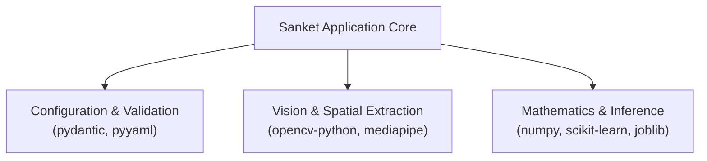

# SANKET (संकेत) — Technology Stack Specification

> **Comprehensive Technology Stack, Dependency Architecture, and Hardware Baseline**  
> *Authoritative specification of runtimes, libraries, developer tooling, and version constraints.*

---

## 1. Runtime Environment & Language Baseline

| Parameter | Specification | Technical Justification |
| :--- | :--- | :--- |
| **Primary Language** | **Python >= 3.10** | Modern structural pattern matching (`match/case`), enhanced typing annotations, standard exception groups, and optimal C-extension compatibility. |
| **Tested Environments** | **Python 3.10, 3.11, 3.12** | Validated across GitHub Actions matrix and local developer workstations (tested on Python 3.12.10). |
| **Execution Platform** | Cross-platform (Windows, Linux, macOS) | Pure Python core with standard C-bindings; executes natively without operating system lock-in. |
| **Hardware Target** | Commodity Edge CPUs | Zero GPU acceleration required for real-time inference; runs entirely on multi-core x86_64 and ARM64 processors. |

---

## 2. Production & Core Dependencies

All dependencies are formally declared in `pyproject.toml` and pinned for reproducibility in `requirements.txt`:

### Core Dependency Matrix

| Package | Version Constraint | Module Usage | Architectural Role |
| :--- | :--- | :--- | :--- |
| **`numpy`** | `>=1.24.0` | `sanket.features`, `sanket.vision` | Vectorized multidimensional array processing, Euclidean norm calculations, trigonometric angle computations, and array slicing. |
| **`pydantic`** | `>=2.4.0` | `sanket.core.config` | Declarative, strictly typed schema validation for configuration parameters with runtime coercion and defaults. |
| **`pyyaml`** | `>=6.0` | `sanket.core.config` | Human-readable configuration parsing for default and environment-specific YAML settings. |
| **`opencv-python`** | `>=4.8.0` | `sanket.vision.capture`, `sanket.ui.overlay` | Video stream acquisition (`cv2.VideoCapture`), letterbox affine transformations, BGR/RGB color formatting, and skeletal HUD drawing. |
| **`mediapipe`** | `>=0.10.0` | `sanket.vision.landmarks`, `sanket.vision.pose` | High-fidelity 3D landmark localization (21 points per hand, 33 points per body pose) optimized via internal graph pipelines. |
| **`scikit-learn`** | `>=1.3.0` | `sanket.models`, `sanket.evaluation` | Machine learning classifiers (`RandomForestClassifier`, `SVC`, `MLPClassifier`), metric calculations (MCC, F1, precision, recall), and data preprocessing. |
| **`joblib`** | `>=1.3.0` | `sanket.models.base` | High-efficiency, zero-copy serialization and persistence of trained estimators and numerical scalers. |

---

## 3. Development, Testing & Code Quality Tooling

Declared in `pyproject.toml` under `[project.optional-dependencies].dev` and pinned in `requirements-dev.txt`:

| Tool | Version Constraint | Purpose & Policy |
| :--- | :--- | :--- |
| **`pytest`** | `>=7.4.0` | Primary test execution harness. Enforces strict markers (`-ra -q --strict-markers`) and discovers tests in `tests/`. |
| **`pytest-cov`** | `>=4.1.0` | Code coverage measurement and branch coverage verification. Minimum target: >= 80% repository-wide. |
| **`ruff`** | `>=0.1.6` | Ultra-fast Rust-based linter and import formatter. Enforces PEP 8, flake8 rules, Pyupgrade (`UP`), and bugbear (`B`) with line-length 100. |
| **`mypy`** | `>=1.6.0` | Static type checker enforcing type safety across all `sanket.*` modules without implicit `Any` types. |
| **`black`** | `>=23.10.0` | Deterministic, uncompromising code formatter configured for line-length 100 and Python 3.10+ target syntax. |

---

## 4. Continuous Integration & Security Automation

| CI Component | Implementation | Security & Governance Standard |
| :--- | :--- | :--- |
| **CI Runner** | GitHub Actions (`ubuntu-latest`) | Executes automated testing matrix across Python 3.10 and 3.11 on every push and pull request. |
| **Action Pinning** | Immutable Commit SHAs | All third-party actions pinned to 40-character commit hashes to eliminate supply chain poisoning attacks (`actions/checkout@11bd71...`, `actions/setup-python@423755...`). |
| **Least Privilege** | `permissions: contents: read` | CI workflows explicitly restrict the default `GITHUB_TOKEN` to read-only repository permissions. |
| **PR Governance** | `pr-metadata.yml` | Validates Conventional Commits PR titles, milestone attachment, 4-tier labels, closing issue links, and test proof. |
| **Dependabot** | `.github/dependabot.yml` | Weekly automated vulnerability scanning and dependency updates for GitHub Actions and pip packages. |

---

## 5. Hardware Specifications & Edge Constraints

### Recommended Host Requirements (Inference Runtime)
- **Processor**: Quad-core x86_64 or ARM64 CPU @ >= 2.0 GHz (e.g., Intel Core i5/i7, AMD Ryzen 5, Apple Silicon M1/M2/M3, Raspberry Pi 5).
- **RAM**: Minimum 4 GB RAM (pipeline memory consumption < 250 MB).
- **Storage**: < 100 MB installed footprint (library and models).
- **Camera Sensor**: Standard UVC USB or built-in RGB webcam supporting 640x480 resolution @ 30 FPS.
- **Operating Systems**: Windows 10/11, Ubuntu 20.04/22.04 LTS, Debian 11/12, macOS 12+ (Monterey, Ventura, Sonoma).

