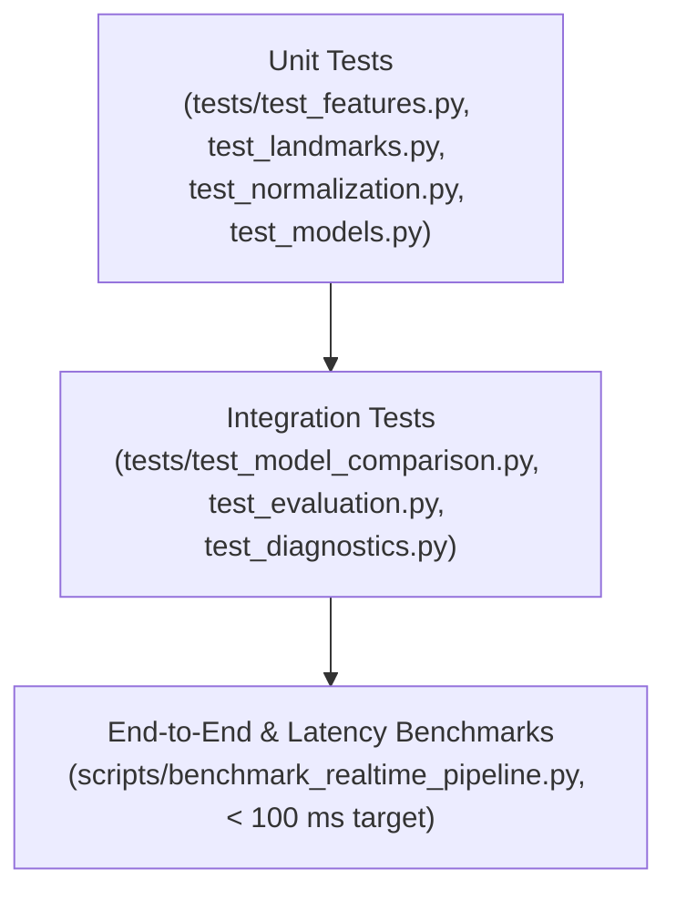

# SANKET (संकेत) — Testing & Evaluation Guide

> **Testing Strategy, Benchmarking Protocols, and Quality Verification**  
> *Authoritative guide to automated testing, synthetic fixture generation, and latency profiling.*

---

## 1. Testing Philosophy & Verification Levels

SANKET adheres to a strict multi-tier testing pyramid to guarantee mathematical correctness, real-time performance, and CI determinism:



1. **Unit Tests (Fast & Isolated)**: Test individual pure functions, coordinate transformations, normalization mathematics, and feature extractors using synthetic deterministic inputs.
2. **Integration Tests (Subsystem Pipelines)**: Validate complete dataflows (e.g. Landmark Extraction $\rightarrow$ Feature Extractor $\rightarrow$ Classifier Fit $\rightarrow$ Evaluation Report Manifest).
3. **Headless Execution & Mocks**: Full CI test execution without requiring physical webcam hardware or external dataset downloads using `MockVideoCapture` and synthetic landmark generators.
4. **Latency & Performance Benchmarks**: High-resolution timer instrumentation measuring p50, p90, p95, p99 latency percentiles and CPU throughput.

---

## 2. Test Suite Organization

All tests reside in `tests/` and mirror the core architecture of `src/sanket/`:

| Test Module | Coverage Area | Key Verification Scenarios |
| :--- | :--- | :--- |
| `test_foundation.py` | `sanket.core.config` | Pydantic schema validation, default configuration loading, invalid field handling. |
| `test_data_ingestion.py` | `sanket.data.ingestion` | File integrity verification, archive decompression, missing file errors. |
| `test_data_inspection.py` | `sanket.data.inspection` | Label distribution calculations, class imbalance metrics, signer counts. |
| `test_data_splits.py` | `sanket.data.splits` | Signer-Independent splitting verification, zero-leakage assertions across splits. |
| `test_video_preprocessing.py`| `sanket.vision.preprocessing`| Letterbox resizing aspect preservation, horizontal mirroring, color conversions. |
| `test_landmarks.py` | `sanket.vision.landmarks` | MediaPipe Hands integration, 21-point coordinate structures, missing hand handling. |
| `test_pose_investigation.py` | `sanket.vision.pose` | MediaPipe Pose upper-body anchor points (shoulders, elbows, nose). |
| `test_landmark_normalization.py`| `sanket.vision.normalization`| Wrist translation invariance, palm scale normalization mathematics, degenerate inputs. |
| `test_features.py` | `sanket.features` | Joint angle trigonometry, pairwise Euclidean distances, temporal pooling, 645-dim shape. |
| `test_random_forest.py` | `sanket.models.random_forest` | Fit, predict, predict_proba, serialization via Joblib, deterministic random seed. |
| `test_svm.py` | `sanket.models.svm` | SVM RBF kernel training, StandardScaler pipeline integration, probability estimation. |
| `test_mlp.py` | `sanket.models.mlp` | Multi-Layer Perceptron architecture, Adam optimization, convergence checks. |
| `test_evaluation.py` | `sanket.evaluation` | Top-1, Top-5, Macro F1, MCC metric accuracy, latency profiling, manifest JSON output. |
| `test_diagnostics.py` | `sanket.evaluation.diagnostics` | Confusion matrix computation, per-class error breakdown, phonological analysis. |
| `test_model_comparison.py` | `sanket.evaluation` | Cross-model comparative benchmarking and decision record validation. |

---

## 3. Running Tests Locally

### Quick Execution
```bash
# Execute full suite quietly (standard run)
pytest -q

# Execute full suite with detailed test names and timing
pytest -v --durations=10
```

### Module-Specific Testing
```bash
# Test only feature extraction
pytest tests/test_features.py -v

# Test only baseline classifiers
pytest tests/test_random_forest.py tests/test_svm.py tests/test_mlp.py -v
```

### Coverage Measurement
```bash
# Generate terminal coverage report
pytest --cov=sanket tests/

# Generate detailed HTML coverage report (viewable in browser)
pytest --cov=sanket --cov-report=html tests/
```

---

## 4. Synthetic Data Generation Strategy

To ensure tests run deterministically in CI environments without requiring physical human signers or multi-gigabyte video files:

```python
import numpy as np

def generate_synthetic_landmarks(n_frames: int = 30) -> np.ndarray:
    """Generate synthetic 2-hand 21-landmark 3D coordinate sequence.
    
    Returns:
        np.ndarray of shape (n_frames, 2, 21, 3) with realistic spatial variance.
    """
    rng = np.random.default_rng(seed=42)
    # Base wrist position at origin
    landmarks = rng.normal(loc=0.0, scale=0.1, size=(n_frames, 2, 21, 3))
    # Ensure palm size (wrist index 0 to middle MCP index 9) is non-zero
    landmarks[:, :, 9, :] = landmarks[:, :, 0, :] + 0.15
    return landmarks
```

---

## 5. Performance & Latency Benchmarking Protocol

As specified in `docs/research/EVALUATION_METHODOLOGY.md`:
1. **Warmup**: Perform 50 warmup inference passes prior to recording timestamps to prime instruction caches and CPU frequency governor.
2. **Measurement**: Measure per-sample latency across $\ge 500$ evaluations using `time.perf_counter_ns()`.
3. **Percentile Computation**: Compute p50 (median), p90, p95, and p99 percentiles.
4. **Target Gates**:
   - `p95 <= 25.0 ms`
   - `median <= 15.0 ms`
   - `throughput >= 25.0 FPS`

