# System Architecture Overview — Sanket

## 1. System Mission
Sanket is designed as a modular, privacy-preserving, accessible computer vision pipeline that recognizes Indian Sign Language (ISL) gestures from standard RGB camera input and translates them into textual and vocal output.

---

## 2. High-Level Data Flow

```mermaid
flowchart LR
    A["Camera Input\n(Webcam / Video)"] --> B["Vision Preprocessing\n(Frame Resize / FPS Sync)"]
    B --> C["Landmark Tracking\n(MediaPipe Hands & Pose)"]
    C --> D["Feature Normalization\n(Origin Shift & Scale)"]
    D --> E["Temporal Buffer\n(Sliding Window)"]
    E --> F["Recognition Engine\n(Baseline / LSTM / GRU)"]
    F --> G["Prediction Smoothing\n(Confidence & Filtering)"]
    G --> H["Language Processing\n(Gloss → Sentence)"]
    H --> I["Accessible Output\n(UI Display & TTS)"]
```

---

## 3. Subsystem Breakdown

### 3.1. Vision & Acquisition Subsystem (`sanket.vision`)
- **Camera Capture**: Interfaces with standard OpenCV video streams.
- **Landmark Detection**: Employs MediaPipe Hands (21 3D landmarks per hand) and optionally MediaPipe Pose (33 upper-body keypoints).
- **Coordinate Normalization**: Normalizes coordinates relative to the wrist origin $(x_0, y_0, z_0)$ and scales by the distance between the wrist and middle finger MCP joint to achieve scale-invariance and distance-invariance.

### 3.2. Machine Learning Subsystem (`sanket.models`)
- **Feature Extraction**: Converts raw landmark keypoints into fixed-length feature vectors:
  - Static: $21 \times 3 = 63$ coordinates per hand.
  - Two-handed: $42 \times 3 = 126$ coordinates.
- **Phase 1 Baseline Classifiers**: Random Forest, Support Vector Machines (SVM), Multi-Layer Perceptrons (MLP).
- **Phase 3 Temporal Sequence Classifiers**: Bidirectional LSTM / GRU architectures operating on sliding windows ($T \times D$).
- **Inference Runtime**: Standardized `.predict()` and `.predict_proba()` interfaces.

### 3.3. Natural Language & Synthesis Subsystem (`sanket.language`)
- **Token Accumulator**: Buffers predicted sign classes over time, deduplicating consecutive identical predictions.
- **Confidence Gate**: Drops low-confidence predictions ($\tau < 0.70$) to prevent noise accumulation.
- **Language Layer**: Maps ISL sign gloss sequences to natural language sentences.
- **Text-to-Speech (TTS)**: Synthesizes spoken audio for auditory accessibility.

### 3.4. User Interface & Configuration Subsystem (`sanket.ui`, `configs/`)
- Real-time overlay showing tracked hand skeleton and recognized sign text.
- Centralized YAML configuration files managing camera device indices, landmark thresholds, model paths, and UI parameters.
