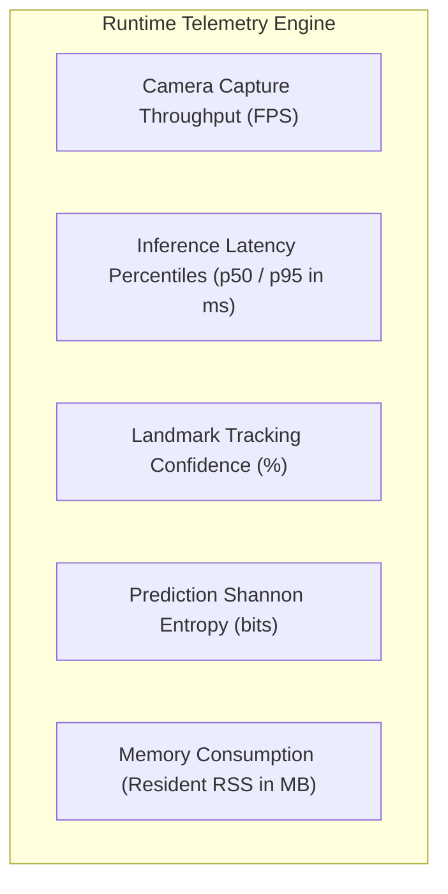

# SANKET (संकेत) — Runtime Monitoring & Performance Telemetry

> **Operational Telemetry, Latency Profiling, Health Checks, and Drift Detection**  
> *Authoritative specifications for observing real-time pipeline performance.*

---

## 1. Real-Time Telemetry Metrics

During live camera execution (`scripts/run_realtime_mvp.py`), the runtime system monitors five core performance and quality indicators:



### Telemetry Specifications

| Metric | Target Baseline | Warning Threshold | Critical Action |
| :--- | :---: | :---: | :--- |
| **Capture Throughput** | $\ge 30\text{ FPS}$ | $< 20\text{ FPS}$ | Trigger frame drop warnings; lower camera resolution to $640 \times 480$. |
| **Inference Latency (p95)**| $\le 25\text{ ms}$ | $> 50\text{ ms}$ | Profile background CPU tasks; verify multi-threading. |
| **Tracking Confidence** | $\ge 70\%$ | $< 50\%$ | Display "Low Lighting / Hand Occluded" visual alert on HUD. |
| **Prediction Entropy** | $\le 1.5\text{ bits}$ | $> 2.5\text{ bits}$ | Gate output to `NO_SIGN` / `IDLE` (rejects ambiguous gestures). |
| **Resident Memory (RSS)** | $< 250\text{ MB}$ | $> 500\text{ MB}$ | Inspect frame queues for unbounded memory leaks; flush buffers. |

---

## 2. On-Screen HUD Telemetry Display

When running in GUI mode with `--show-hud`, real-time operational statistics are rendered in the top-right corner of the video frame:

```text
[TELEMETRY HUD]
CAMERA FPS:   30.1 FPS  [OK]
INFERENCE:    0.73 ms   [OK]
PIPELINE P95: 18.4 ms   [OK]
TRACKING:     2 HANDS   [OK]
```

---

## 3. Automated Benchmark Telemetry in CI

In continuous integration and benchmarking scripts (`scripts/benchmark_realtime_pipeline.py`), metrics are structured and logged as JSON manifests:

```bash
python scripts/benchmark_realtime_pipeline.py \
    --duration-seconds 60 \
    --output-json docs/experiments/manifests/TELEMETRY-BENCHMARK.json
```

These manifests record latency distributions and throughput stability for regression tracking across git commits.

