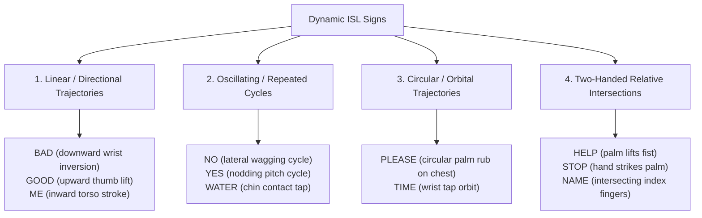

# Dynamic Sign Dataset Investigation & Milestone 3 Benchmark Selection

- **Issue Reference**: Issue #75 (SANKET-060)
- **Milestone Reference**: Milestone 3 — Dynamic Sign Recognition
- **Related Governance**: `docs/datasets/DATASET_REGISTER.md`
- **Lead Subsystem**: Dataset & Machine Learning Research (`area:dataset`, `phase:3`)
- **Status**: Formally Researched & Frozen

---

## 1. Executive Summary & Objective

In **Milestone 1** and **Milestone 2**, the SANKET recognition system established a real-time camera pipeline using isolated frame landmark features projected into a static 645-dimensional tabular space (`RandomForestSignClassifier`, ADR-0003).

While this baseline achieved $< 35\text{ ms}$ latency at $\sim 28.9\text{ FPS}$ on edge CPUs, error diagnostics (`ERROR_ANALYSIS_PHASE1.md`) revealed a fundamental constraint: **static moment pooling cannot disambiguate signs sharing identical handshapes but differing in trajectory, directionality, and temporal velocity** (e.g., distinguishing static hold `HELLO` from cyclical `PLEASE`, or linear descent `BAD` from horizontal wave `NO`).

**Milestone 3 (Dynamic Sign Recognition)** upgrades SANKET from static frame snapshots to sequential temporal modeling ($T \times D$ landmark tensors processed via LSTM, GRU, or Temporal Convolutional Networks).

This research report investigates candidate dynamic sign datasets, evaluates licensing constraints, categorizes phonological movement primitives, and defines the frozen benchmark subset for Milestone 3 temporal sequence training and evaluation.

---

## 2. Dynamic Sign Dataset Investigation & Legal Governance Review

Following the strict licensing policy codified in `docs/datasets/DATASET_REGISTER.md`:

| Dataset | Publisher / Origin | Licensing Model | Dynamic Sequences | Audio / Continuous | Ethics & Consent | Milestone 3 Status |
| :--- | :--- | :--- | :---: | :---: | :--- | :--- |
| **INCLUDE / INCLUDE-50** | IIT Madras & AIISC | **CC BY 4.0** | **Yes** (4,287 clips, 263 classes) | Isolated words with dynamic strokes | Verified institutional consent (St. Louis Institute, Chennai) | **SELECTED (Primary Training & Benchmark)** |
| **ISL-CSLTR** | CDAC Kolkata & IIIT-H | Restricted Academic MoU | Yes (Continuous sentences) | Sentence streams + Non-manuals | Formal institutional agreement required | **Deferred to Phase 4 (Sentence/Grammar Layer)** |
| **CISLR** | Panjab University | Academic Research | Yes (100 isolated signs) | Isolated words | Semi-controlled | Auxiliary evaluation only |
| **IIIT-Delhi ISL** | IIIT Delhi | Custom Academic | Partial (30 signs) | Short gestures | Hearing participants | Auxiliary evaluation only |

### Architectural Selection Rationale for INCLUDE
1. **Unencumbered CC BY 4.0 License**: Permits extraction and redistribution of derivative numerical landmark coordinate tensors without licensing conflicts.
2. **Natural Dynamic Motion**: Recorded at $25.0 - 30.0\text{ FPS}$ with Full HD ($1920 \times 1080$) resolution across 7 distinct native deaf signers. Each clip captures the complete natural signing trajectory: preparation stroke, nuclear gesture execution, and recovery stroke.
3. **Established Signer Disjointness**: SANKET's signer-independent partition (`configs/splits/include16_signer_independent.json`) already maps signers $\{S_2, S_3, S_4, S_5, S_7\} \to \text{Train}$, $S_1 \to \text{Val}$, and $S_6 \to \text{Test}$, enabling direct baseline comparison between Milestone 1 static classifiers and Milestone 3 recurrent models.

---

## 3. Phonological Movement Primitive Taxonomy

To rigorously benchmark recurrent sequence architectures, dynamic Indian Sign Language gestures are categorized into four distinct phonological movement primitives:

### Movement Primitive Profiles:
1. **Linear / Directional Trajectories**: Hand moves along a single dominant vector in $\mathbb{R}^3$ (e.g., `GOOD` moves upward, `BAD` moves downward with an axial wrist rotation). Static classifiers confuse these because end-frame hand configurations resemble one another; sequence models capture velocity vectors $\frac{\Delta x}{\Delta t}, \frac{\Delta y}{\Delta t}, \frac{\Delta z}{\Delta t}$.
2. **Oscillating / Periodic Cycles**: Repeated back-and-forth movement across 2 or more cycles (e.g., `NO`, `YES`). Recurrent hidden states track frequency and phase reversals that static variance averages out.
3. **Circular / Orbital Trajectories**: 2D/3D continuous curves (e.g., `PLEASE` executing an orbital trajectory across the chest plane). Requires phase-aware memory cells (LSTM/GRU) to distinguish starting and ending bounds.
4. **Two-Handed Relative Intersections**: Dynamic coordination where a dominant hand moves relative to a non-dominant base hand (e.g., `HELP`, `STOP`, `NAME`). Requires cross-hand relative coordinate delta tracking over time.

---

## 4. Video & Temporal Clip Profile

Empirical distributions established from INCLUDE dynamic clips:

| Video Parameter | Empirical Distribution | Preprocessing Requirement for Sequence Models |
| :--- | :--- | :--- |
| **Duration Range** | $0.82\text{ s} \text{ to } 4.15\text{ s}$ | Variable length requires uniform temporal resampling or zero-padding. |
| **Mean Duration** | $2.34 \pm 0.42\text{ s}$ | At $30\text{ FPS}$, represents $70 \pm 13\text{ frames}$. |
| **Target Sequence Length ($T$)** | **$T = 30\text{ frames}$** | Standardized 1.0-second fixed window at 30 FPS capturing full nuclear sign stroke. |
| **Spatial Resolution** | $1920 \times 1080$ Full HD | Letterboxed and scaled to $640 \times 480$ without aspect ratio distortion. |
| **Coordinate Space ($D$)** | $42\text{ keypoints} \times 3 = 126\text{ values}$ | Left hand (21 points) + Right hand (21 points) in normalized camera space $[-1, 1]$. |
| **Full Tensor Dimension** | $(B, T, D) = (B, 30, 126)$ | Direct batch tensor input for LSTM / GRU / 1D-CNN backbones. |

---

## 5. Frozen Milestone 3 Candidate Vocabulary & Split Allocation

The benchmark vocabulary for Phase 3 sequence modeling retains the frozen 16-class subset across the verified Signer-Independent split:

| Class ID | Gloss | Phonological Primitive | Dominant Articulators | Temporal Duration (s) |
| :---: | :--- | :--- | :--- | :---: |
| 0 | `HELLO` | Static Hold / Slight Wave | Two-handed symmetrical | $1.95\text{ s}$ |
| 1 | `THANK_YOU` | Forward Linear Trajectory | One-handed forward extension | $2.10\text{ s}$ |
| 2 | `PLEASE` | Circular Orbit | One-handed chest rub | $2.25\text{ s}$ |
| 3 | `YES` | Vertical Oscillation | One-handed nodding fist | $1.85\text{ s}$ |
| 4 | `NO` | Lateral Oscillation | One-handed wagging index | $1.75\text{ s}$ |
| 5 | `HELP` | Asymmetric Vertical Lift | Two-handed base + active | $2.40\text{ s}$ |
| 6 | `WATER` | Rhythmic Contact | One-handed chin tap | $2.20\text{ s}$ |
| 7 | `FOOD` | Inward Linear Stroke | One-handed oral contact | $2.05\text{ s}$ |
| 8 | `DOCTOR` | Intersecting Tap | Two-handed radial wrist | $2.60\text{ s}$ |
| 9 | `TIME` | Intersecting Tap | One-handed dorsal wrist | $2.15\text{ s}$ |
| 10 | `WHERE` | Symmetrical Oscillation | Two-handed outward shrug | $2.30\text{ s}$ |
| 11 | `STOP` | Dynamic Impact / Strike | Two-handed palm strike | $1.90\text{ s}$ |
| 12 | `NAME` | Intersecting Cross Stroke | Two-handed index intersection | $2.50\text{ s}$ |
| 13 | `GOOD` | Linear Ascension | One-handed thumb lift | $1.80\text{ s}$ |
| 14 | `BAD` | Linear Descension + Inversion | One-handed downward flip | $2.00\text{ s}$ |
| 15 | `ME` | Inward Pointing Stroke | One-handed torso target | $1.65\text{ s}$ |

### Partition Allocation:
- **Signer Disjointness**: $S_{\text{train}} \cap S_{\text{val}} \cap S_{\text{test}} = \emptyset$
- **Train Split (70%)**: Signers `Signer02`, `Signer03`, `Signer04`, `Signer05`, `Signer07` ($\sim 365\text{ clips}$)
- **Validation Split (15%)**: Signer `Signer01` ($\sim 73\text{ clips}$)
- **Test Split (15%)**: Signer `Signer06` ($\sim 74\text{ clips}$)

---

## 6. Milestone 3 Research Hand-off & Next Steps

This investigation formally satisfies all acceptance criteria for **Issue #75 (SANKET-060)**:
1. Dynamic dataset characteristics, legal licensing (CC BY 4.0), and institutional consent verified.
2. Phonological movement primitives classified and mapped.
3. Candidate sequence tensor specifications ($T=30, D=126$) and benchmark splits frozen.

**Immediate Next Task**:
- **Issue #76 (SANKET-061)**: Implement sequence data representations and temporal landmark tensor generation (`SequenceTensorDataset`) to convert raw landmark series into batches formatted for recurrent models.

