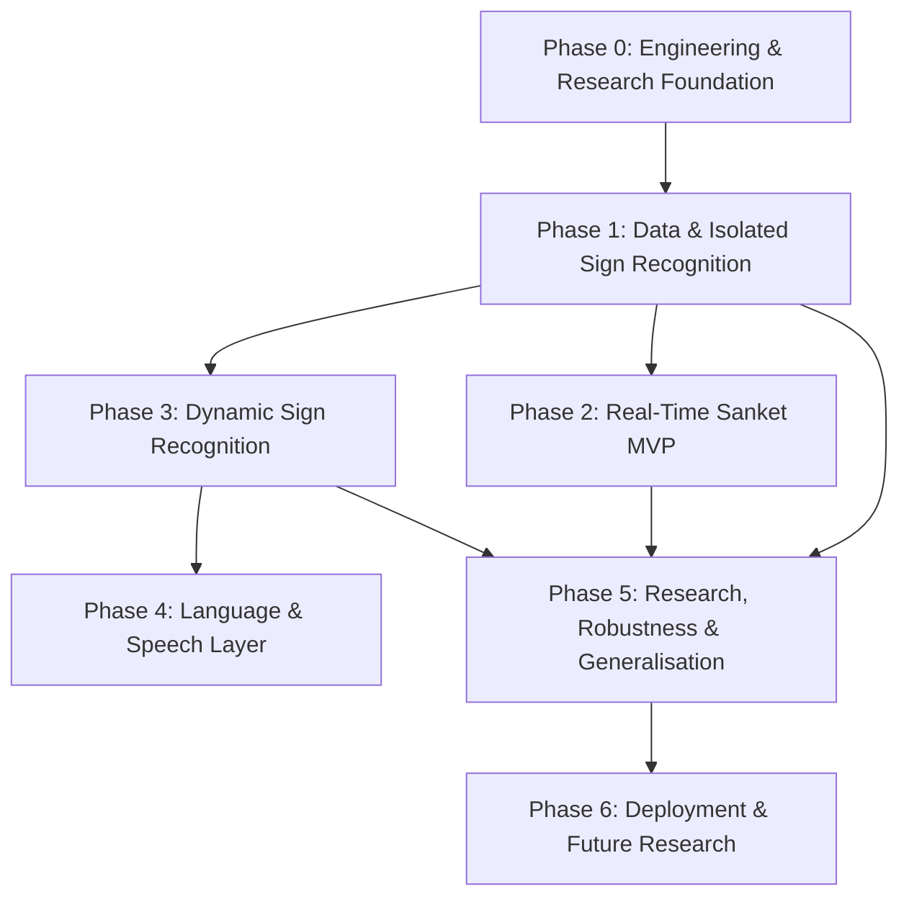

# SANKET MASTER DEVELOPMENT ROADMAP

## Overview & Scope
**Sanket — AI-Assisted Indian Sign Language Accessibility System** is an academic and research-oriented AI project whose initial goal is to recognize a constrained vocabulary of Indian Sign Language (ISL) from camera/video input and convert recognized signs into accessible text and optionally speech.

This roadmap serves as the single source of truth for engineering milestones, research questions, deliverables, and sequential phase dependencies.

---

## Roadmap Principles
1. **Sequential Execution**: Phase progression is strictly gated. Future phases do not begin until the current phase deliverable is completed and validated.
2. **Controlled Vocabulary First**: We do not claim full continuous sign language translation when the system only performs constrained, isolated sign recognition.
3. **Reproducibility**: Every model, data split, and baseline must be reproducible offline before being adapted for real-time inference.
4. **Data Governance**: Dataset licenses, signer consent, and biometric privacy must be formally verified prior to data ingestion.

---

## Phase Dependencies & Progression Graph

---

## Phase 0 — Engineering & Research Foundation

### Objective
Establish the engineering, documentation, dataset governance, security, and research foundation before model development.

### Issues
- **SANKET-001**: Repository & project structure
- **SANKET-002**: GitHub Wiki structure
- **SANKET-003**: Repository security configuration
- **SANKET-004**: Branch protection and development workflow
- **SANKET-005**: Issue and PR templates
- **SANKET-006**: Label taxonomy
- **SANKET-007**: Project documentation framework
- **SANKET-008**: Dataset research and comparison
- **SANKET-009**: Dataset licensing/access review
- **SANKET-010**: Initial ISL vocabulary definition
- **SANKET-011**: Research questions and hypotheses
- **SANKET-012**: Evaluation methodology

### Deliverable
A fully structured, secure, and documented project foundation with a clearly defined initial research problem, evaluation protocol, and vocabulary baseline.

### Phase Gate
- [ ] Milestone 0 issues completed and merged via reviewed PRs.
- [ ] Automated CI and branch protection verified on `main`.
- [ ] Dataset licensing approved by project owner in `DATASET_REGISTER.md`.
- [ ] Initial isolated vocabulary frozen with owner sign-off.

---

## Phase 1 — Data & Isolated Sign Recognition

### Objective
Build a reproducible pipeline for recognising a constrained vocabulary of isolated ISL signs using offline frame and landmark processing.

### Issues
- **SANKET-020**: Dataset ingestion pipeline
- **SANKET-021**: Dataset inspection and label analysis
- **SANKET-022**: Train/validation/test split strategy (Signer-Independent)
- **SANKET-023**: Image/video preprocessing
- **SANKET-024**: Hand landmark extraction (MediaPipe Hands)
- **SANKET-025**: Pose/body landmark investigation (MediaPipe Pose)
- **SANKET-026**: Landmark normalization (scale, rotation, translation invariant)
- **SANKET-027**: Feature vector generation
- **SANKET-028**: Baseline Random Forest model
- **SANKET-029**: Baseline SVM model
- **SANKET-030**: Baseline neural network (MLP)
- **SANKET-031**: Model evaluation pipeline
- **SANKET-032**: Confusion matrix and error analysis
- **SANKET-033**: Baseline model comparison

### Deliverable
An offline, reproducible isolated-sign recognition baseline with documented evaluation results, comparison tables, and error analyses in `docs/experiments/`.

### Phase Gate
- [ ] Signer-independent split verified without data leakage.
- [ ] Baselines compared and evaluated on identical test set.
- [ ] Feature representation decision recorded in an ADR.

---

## Phase 2 — Real-Time Sanket MVP

### Objective
Convert the offline recognition pipeline into a usable, low-latency real-time camera prototype.

### Issues
- **SANKET-040**: Webcam/video input pipeline
- **SANKET-041**: Real-time frame processing
- **SANKET-042**: Real-time landmark extraction
- **SANKET-043**: Real-time model inference
- **SANKET-044**: Prediction smoothing (moving window / temporal filtering)
- **SANKET-045**: Confidence scoring and thresholding
- **SANKET-046**: Real-time prediction UI
- **SANKET-047**: Accessible text output display
- **SANKET-048**: End-to-end camera → sign → text pipeline integration
- **SANKET-049**: MVP usability testing

### Deliverable
A working prototype where a live camera captures an isolated ISL sign and Sanket produces a stable prediction and readable text output with latency < 100ms.

### Phase Gate
- [ ] Real-time pipeline operates at >= 20 FPS on standard consumer hardware.
- [ ] Prediction smoothing prevents flicker on static signs.
- [ ] End-to-end user smoke tests pass.

---

## Phase 3 — Dynamic Sign Recognition

### Objective
Investigate temporal dynamics, trajectory modeling, and dynamic sign recognition.

### Issues
- **SANKET-060**: Dynamic-sign dataset investigation
- **SANKET-061**: Sequence data representation (T x D landmark tensors)
- **SANKET-062**: Temporal preprocessing (frame interpolation / uniform sampling)
- **SANKET-063**: Sequence padding and sliding window buffering
- **SANKET-064**: LSTM / GRU baseline model implementation
- **SANKET-065**: Temporal model evaluation
- **SANKET-066**: Static vs temporal model comparison
- **SANKET-067**: Dynamic-sign error analysis

### Deliverable
A documented empirical study demonstrating whether and by how much temporal modeling improves recognition accuracy for moving ISL signs over static frame models.

### Phase Gate
- [ ] Statistical comparison between static frame and temporal sequence models.
- [ ] ADR recorded on temporal modeling architecture.

---

## Phase 4 — Language & Speech Layer

### Objective
Convert recognised sign sequences into meaningful, accessible natural language text and optional speech output.

### Issues
- **SANKET-080**: Sign sequence buffer (holding recognized tokens)
- **SANKET-081**: Sign sequence normalization (removing duplicates / noise)
- **SANKET-082**: Language processing layer (ISL gloss to grammatical English/Hindi)
- **SANKET-083**: Sentence formation rules / heuristics
- **SANKET-084**: Text output formatting and accessibility enhancements
- **SANKET-085**: Text-to-speech (TTS) integration
- **SANKET-086**: Confidence-aware language output
- **SANKET-087**: Language-layer evaluation

### Deliverable
Recognised sign sequences are mapped into coherent sentences and synthesized speech with confidence-rated output.

> [!IMPORTANT]
> Do not describe this phase as full continuous ISL translation unless the empirical evaluation proves continuous syntactic and semantic translation.

---

## Phase 5 — Research, Robustness & Generalisation

### Objective
Evaluate whether Sanket maintains recognition fidelity outside controlled studio environments.

### Issues
- **SANKET-100**: Signer-independent cross-validation
- **SANKET-101**: Lighting robustness testing (low-light, harsh glare, shadows)
- **SANKET-102**: Background robustness (complex, cluttered, moving backgrounds)
- **SANKET-103**: Camera-distance evaluation (near-field vs room-scale)
- **SANKET-104**: Viewpoint variation testing (oblique angles ±30°)
- **SANKET-105**: Occlusion testing (partial hand overlap, torso occlusion)
- **SANKET-106**: Inference latency benchmark
- **SANKET-107**: End-to-end FPS benchmark
- **SANKET-108**: Model size vs performance trade-off analysis
- **SANKET-109**: Comprehensive failure-case taxonomy
- **SANKET-110**: Final academic research evaluation report

### Deliverable
A reproducible, peer-review quality evaluation report covering accuracy, generalization bounds, failure modes, and hardware profiles.

---

## Phase 6 — Deployment & Future Research

### Objective
Package the validated system for accessible deployment and outline future research directions.

### Issues
- **SANKET-120**: Inference API design (REST / WebSocket)
- **SANKET-121**: Model packaging (ONNX runtime / TorchScript)
- **SANKET-122**: Model optimization (quantization, pruning)
- **SANKET-123**: Edge and mobile inference feasibility study
- **SANKET-124**: Camera privacy architecture & on-device zero-retention mode
- **SANKET-125**: Deployment architecture documentation
- **SANKET-126**: Production readiness assessment
- **SANKET-127**: Continuous ISL research plan (Transformer / CTC / Gloss-free)
- **SANKET-128**: Multilingual output research (Regional Indian languages)

### Deliverable
A production-ready, privacy-respecting deployment package and a research proposal for continuous sign translation.
