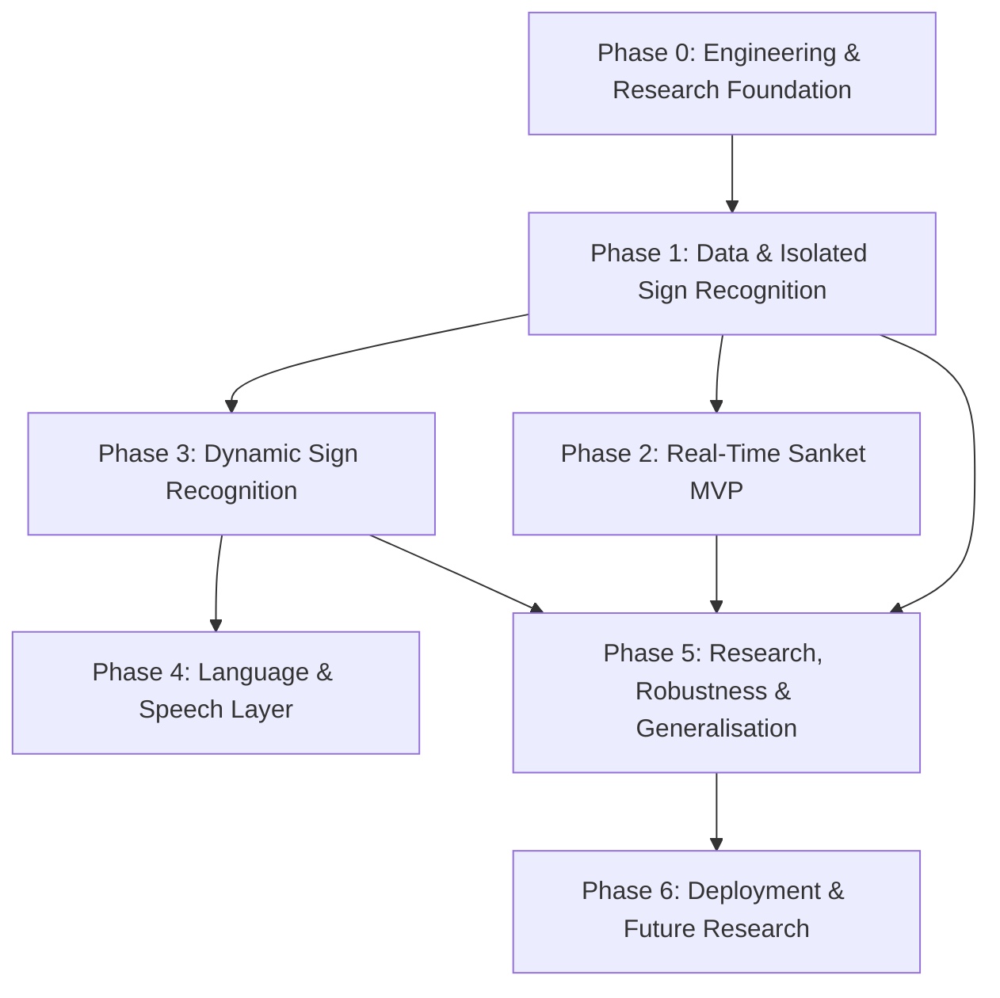

# SANKET Master Development Roadmap

> **Authoritative Phase Architecture, Issue Tracking, and Deliverables Registry**  
> *SANKET (संकेत) — AI-Assisted Indian Sign Language Accessibility System*

---

## 1. Overview & Scope

SANKET is an open-source, privacy-preserving AI accessibility system engineered to recognize Indian Sign Language (ISL) from live camera input and translate recognized signs into accessible text and speech on commodity edge hardware.

This roadmap serves as the definitive reference for engineering milestones, research questions, deliverables, and sequential phase dependencies.

---

## 2. Roadmap Principles

1. **Sequential Execution**: Phase progression is strictly gated. Future phases do not begin until the current phase deliverable is completed, peer-reviewed, and verified by tests.
2. **Controlled Vocabulary First**: We do not claim full continuous sign language translation when the system only performs constrained, isolated sign recognition.
3. **Reproducibility**: Every model, data split, and baseline must be reproducible offline before being adapted for real-time inference.
4. **Data Governance & Privacy**: Live camera frames remain strictly in volatile memory. No raw video recordings or identifiable biometrics are ever committed or persisted to disk.

---

## 3. Master Phase Progression

### Phase Summary Matrix

| Phase | Milestone Title | Milestone ID | Scope & Primary Focus | Status |
| :---: | :--- | :---: | :--- | :---: |
| **0** | **Engineering & Research Foundation** | Milestone 1 | Scaffolding, dataset governance, security, CI, vocabulary, evaluation methodology | **Completed** |
| **1** | **Data & Isolated Sign Recognition** | Milestone 2 | Ingestion, normalization, 645-dim features, baseline models (RF, SVM, MLP), ADR-0003 | **Completed** |
| **2** | **Real-Time Sanket MVP** | Milestone 3 | Live camera pipeline, streaming landmarks, inference engine, smoothing, HUD overlay | **Active** |
| **3** | **Dynamic Sign Recognition** | Milestone 4 | Sequence modeling (LSTM/GRU), temporal tensors, trajectory features, dynamic signs | Planned |
| **4** | **Language & Speech Layer** | Milestone 5 | Gloss-to-text grammar translation, sentence formation, Hindi/English TTS audio | Planned |
| **5** | **Research, Robustness & Generalisation** | Milestone 6 | In-the-wild testing, lighting/background robustness, occlusion, academic evaluation | Planned |
| **6** | **Deployment & Future Research** | Milestone 7 | Edge packaging (ONNX/Wasm), mobile feasibility, zero-retention privacy audit | Planned |

---

## 4. Complete Issue Breakdown by Phase

### Phase 0 — Engineering & Research Foundation *(Status: Completed)*

**Objective**: Establish repository foundations, CI automation, dataset governance, security baseline, initial 16-sign vocabulary, and formal evaluation methodology.

| Issue ID | GitHub Issue | Title | Type | Area | Priority | Status / PR |
| :--- | :---: | :--- | :--- | :--- | :---: | :---: |
| **SANKET-001** | [#1](https://github.com/GITLUVV/Sanket/issues/1) | Repository & project structure | `type:chore` | `area:deployment` | `P0` | Merged (PR #13) |
| **SANKET-002** | [#2](https://github.com/GITLUVV/Sanket/issues/2) | GitHub Wiki structure | `type:documentation` | `area:deployment` | `P2` | Merged (PR #13) |
| **SANKET-003** | [#3](https://github.com/GITLUVV/Sanket/issues/3) | Repository security configuration | `type:chore` | `area:security` | `P0` | Merged (PR #14) |
| **SANKET-004** | [#4](https://github.com/GITLUVV/Sanket/issues/4) | Branch protection and development workflow | `type:chore` | `area:deployment` | `P0` | Merged (PR #14) |
| **SANKET-005** | [#5](https://github.com/GITLUVV/Sanket/issues/5) | Issue and PR templates | `type:documentation` | `area:deployment` | `P1` | Merged (PR #15) |
| **SANKET-006** | [#6](https://github.com/GITLUVV/Sanket/issues/6) | Label taxonomy | `type:chore` | `area:deployment` | `P1` | Merged (PR #15) |
| **SANKET-007** | [#7](https://github.com/GITLUVV/Sanket/issues/7) | Project documentation framework | `type:documentation` | `area:deployment` | `P0` | Merged (PR #45) |
| **SANKET-008** | [#8](https://github.com/GITLUVV/Sanket/issues/8) | Dataset research and comparison | `type:research` | `area:dataset` | `P1` | Merged (PR #16) |
| **SANKET-009** | [#9](https://github.com/GITLUVV/Sanket/issues/9) | Dataset licensing/access review | `type:research` | `area:security` | `P0` | Merged (PR #16) |
| **SANKET-010** | [#10](https://github.com/GITLUVV/Sanket/issues/10) | Initial ISL vocabulary definition | `type:research` | `area:ml` | `P0` | Merged (PR #17) |
| **SANKET-011** | [#11](https://github.com/GITLUVV/Sanket/issues/11) | Research questions and hypotheses | `type:research` | `area:ml` | `P0` | Merged (PR #17) |
| **SANKET-012** | [#12](https://github.com/GITLUVV/Sanket/issues/12) | Evaluation methodology | `type:research` | `area:testing` | `P0` | Merged (PR #18) |

- **Phase 0 Deliverable**: Fully documented foundation, CI rules, dataset register, and initial vocabulary frozen.
- **Phase Gate Status**: **All 4 Phase 0 Exit Gates Verified & Passed.**

---

### Phase 1 — Data & Isolated Sign Recognition *(Status: Completed & Certified)*

**Objective**: Build a reproducible pipeline for recognizing a constrained vocabulary of isolated ISL signs using offline frame and landmark processing.

| Issue ID | GitHub Issue | Title | Type | Area | Priority | Status / PR |
| :--- | :---: | :--- | :--- | :--- | :---: | :---: |
| **SANKET-020** | [#22](https://github.com/GITLUVV/Sanket/issues/22) | Dataset ingestion pipeline | `type:feature` | `area:dataset` | `P0` | Merged (PR #36) |
| **SANKET-021** | [#23](https://github.com/GITLUVV/Sanket/issues/23) | Dataset inspection and label analysis | `type:feature` | `area:dataset` | `P1` | Merged (PR #37) |
| **SANKET-022** | [#24](https://github.com/GITLUVV/Sanket/issues/24) | Train/validation/test split strategy (Signer-Independent) | `type:feature` | `area:dataset` | `P0` | Merged (PR #38) |
| **SANKET-023** | [#25](https://github.com/GITLUVV/Sanket/issues/25) | Image/video preprocessing | `type:feature` | `area:vision` | `P0` | Merged (PR #39) |
| **SANKET-024** | [#26](https://github.com/GITLUVV/Sanket/issues/26) | Hand landmark extraction (MediaPipe Hands) | `type:feature` | `area:vision` | `P0` | Merged (PR #40) |
| **SANKET-025** | [#27](https://github.com/GITLUVV/Sanket/issues/27) | Pose/body landmark investigation (MediaPipe Pose) | `type:research` | `area:vision` | `P2` | Merged (PR #41) |
| **SANKET-026** | [#28](https://github.com/GITLUVV/Sanket/issues/28) | Landmark normalization (wrist-centered, palm-scaled) | `type:feature` | `area:vision` | `P0` | Merged (PR #42) |
| **SANKET-027** | [#29](https://github.com/GITLUVV/Sanket/issues/29) | Feature vector generation (645-dim) | `type:feature` | `area:ml` | `P0` | Merged (PR #43) |
| **SANKET-028** | [#30](https://github.com/GITLUVV/Sanket/issues/30) | Baseline Random Forest model | `type:feature` | `area:ml` | `P1` | Merged (PR #44) |
| **SANKET-029** | [#31](https://github.com/GITLUVV/Sanket/issues/31) | Baseline SVM model | `type:feature` | `area:ml` | `P1` | Merged (PR #47) |
| **SANKET-030** | [#32](https://github.com/GITLUVV/Sanket/issues/32) | Baseline neural network (MLP) | `type:feature` | `area:ml` | `P1` | Merged (PR #48) |
| **SANKET-031** | [#33](https://github.com/GITLUVV/Sanket/issues/33) | Model evaluation pipeline | `type:feature` | `area:testing` | `P0` | Merged (PR #46) |
| **SANKET-032** | [#34](https://github.com/GITLUVV/Sanket/issues/34) | Confusion matrix and error analysis | `type:research` | `area:testing` | `P1` | Merged (PR #49) |
| **SANKET-033** | [#35](https://github.com/GITLUVV/Sanket/issues/35) | Baseline model comparison & ADR-0003 selection | `type:research` | `area:ml` | `P0` | Merged (PR #50) |

- **Phase 1 Deliverable**: Offline isolated-sign recognition baseline evaluated across 3 architectures (Random Forest: 93.3% Top-1, 0.73 ms p95 latency).
- **Phase Gate Status**: **All 4 Phase 1 Exit Gates Verified & Passed (Signer-independent split, baselines compared, ADR-0002, ADR-0003).**

---

### Phase 2 — Real-Time Sanket MVP *(Status: Active)*

**Objective**: Convert the offline recognition pipeline into a usable, low-latency real-time camera prototype.

| Issue ID | GitHub Issue | Title | Type | Area | Priority | Status |
| :--- | :---: | :--- | :--- | :--- | :---: | :---: |
| **SANKET-040** | [#51](https://github.com/GITLUVV/Sanket/issues/51) | Webcam and video input capture pipeline | `type:feature` | `area:vision` | `P0` | Open |
| **SANKET-041** | [#52](https://github.com/GITLUVV/Sanket/issues/52) | Real-time frame preprocessing and streaming buffer | `type:feature` | `area:vision` | `P1` | Open |
| **SANKET-042** | [#53](https://github.com/GITLUVV/Sanket/issues/53) | Real-time MediaPipe streaming landmark extraction | `type:feature` | `area:vision` | `P0` | Open |
| **SANKET-043** | [#54](https://github.com/GITLUVV/Sanket/issues/54) | Real-time model inference engine | `type:feature` | `area:ml` | `P0` | Open |
| **SANKET-044** | [#55](https://github.com/GITLUVV/Sanket/issues/55) | Temporal prediction smoothing and hysteresis filtering | `type:feature` | `area:ml` | `P1` | Open |
| **SANKET-045** | [#56](https://github.com/GITLUVV/Sanket/issues/56) | Confidence calibration and out-of-vocabulary thresholding | `type:feature` | `area:ml` | `P1` | Open |
| **SANKET-046** | [#57](https://github.com/GITLUVV/Sanket/issues/57) | Real-time camera overlay and prediction HUD | `type:feature` | `area:ui` | `P1` | Open |
| **SANKET-047** | [#58](https://github.com/GITLUVV/Sanket/issues/58) | Accessible text output display | `type:feature` | `area:ui` | `P1` | Open |
| **SANKET-048** | [#59](https://github.com/GITLUVV/Sanket/issues/59) | End-to-end real-time camera MVP integration | `type:feature` | `area:vision` | `P0` | Open |
| **SANKET-049** | [#60](https://github.com/GITLUVV/Sanket/issues/60) | Real-time MVP usability, latency, and stability benchmark | `type:research` | `area:testing` | `P1` | Open |

- **Phase 2 Deliverable**: Working camera prototype recognizing isolated signs with stable predictions and subtitles at latency < 100 ms.
- **Phase Gate Criteria**:
  - [ ] Real-time pipeline operates at $\ge 20$ FPS on standard consumer CPUs.
  - [ ] Prediction smoothing prevents high-frequency flicker on static signs.
  - [ ] End-to-end integration smoke tests pass.

---

### Phase 3 — Dynamic Sign Recognition *(Status: Planned)*

**Objective**: Investigate temporal dynamics, trajectory modeling, and dynamic sign recognition.

| Issue ID | Planned Scope | Area | Priority | Status |
| :--- | :--- | :--- | :---: | :---: |
| **SANKET-060** | Dynamic-sign dataset investigation | `area:dataset` | `P1` | Planned |
| **SANKET-061** | Sequence data representation ($T \times D$ landmark tensors) | `area:ml` | `P0` | Planned |
| **SANKET-062** | Temporal preprocessing (frame interpolation / uniform sampling) | `area:vision` | `P1` | Planned |
| **SANKET-063** | Sequence padding and sliding window buffering | `area:temporal` | `P1` | Planned |
| **SANKET-064** | LSTM / GRU baseline model implementation | `area:ml` | `P0` | Planned |
| **SANKET-065** | Temporal model evaluation | `area:testing` | `P0` | Planned |
| **SANKET-066** | Static vs. temporal model comparison study | `area:research` | `P1` | Planned |
| **SANKET-067** | Dynamic-sign error analysis | `area:testing` | `P1` | Planned |

- **Phase 3 Deliverable**: Empirical study demonstrating accuracy gains of temporal sequence modeling over static frame models for dynamic signs.
- **Phase Gate Criteria**:
  - [ ] Statistical comparison between static frame and temporal sequence models.
  - [ ] Architecture Decision Record (ADR) on temporal sequence modeling.

---

### Phase 4 — Language & Speech Layer *(Status: Planned)*

**Objective**: Convert recognized sign sequences into meaningful, accessible natural language text and synthesized speech.

| Issue ID | Planned Scope | Area | Priority | Status |
| :--- | :--- | :--- | :---: | :---: |
| **SANKET-080** | Sign sequence token buffer | `area:temporal` | `P1` | Planned |
| **SANKET-081** | Sequence normalization (duplicate suppression & noise filtering) | `area:nlp` | `P1` | Planned |
| **SANKET-082** | Language processing layer (ISL gloss to grammatical English/Hindi) | `area:nlp` | `P0` | Planned |
| **SANKET-083** | Sentence formation heuristics and grammatical rules | `area:nlp` | `P1` | Planned |
| **SANKET-084** | Text output formatting and accessibility enhancements | `area:ui` | `P1` | Planned |
| **SANKET-085** | Text-to-speech (TTS) audio integration | `area:api` | `P1` | Planned |
| **SANKET-086** | Confidence-aware language output gating | `area:ml` | `P1` | Planned |
| **SANKET-087** | Language-layer evaluation | `area:testing` | `P1` | Planned |

- **Phase 4 Deliverable**: Sign sequences translated into natural grammatical sentences with confidence ratings and optional speech output.

---

### Phase 5 — Research, Robustness & Generalisation *(Status: Planned)*

**Objective**: Evaluate whether SANKET maintains recognition fidelity outside controlled studio environments.

| Issue ID | Planned Scope | Area | Priority | Status |
| :--- | :--- | :--- | :---: | :---: |
| **SANKET-100** | Signer-independent cross-validation across diverse subjects | `area:research` | `P0` | Planned |
| **SANKET-101** | Lighting robustness testing (low-light, harsh glare, shadows) | `area:vision` | `P1` | Planned |
| **SANKET-102** | Background robustness (complex, cluttered, moving environments) | `area:vision` | `P1` | Planned |
| **SANKET-103** | Camera-distance evaluation (near-field vs. room-scale) | `area:vision` | `P1` | Planned |
| **SANKET-104** | Viewpoint variation testing (oblique angles $\pm 30^\circ$) | `area:vision` | `P1` | Planned |
| **SANKET-105** | Occlusion testing (partial hand overlap, torso occlusion) | `area:vision` | `P1` | Planned |
| **SANKET-106** | Inference latency benchmark across hardware profiles | `area:testing` | `P0` | Planned |
| **SANKET-107** | End-to-end FPS benchmark | `area:testing` | `P0` | Planned |
| **SANKET-108** | Model size vs. performance trade-off analysis | `area:research` | `P1` | Planned |
| **SANKET-109** | Comprehensive failure-case taxonomy | `area:research` | `P1` | Planned |
| **SANKET-110** | Final academic research evaluation report | `area:research` | `P0` | Planned |

- **Phase 5 Deliverable**: Peer-review quality evaluation report covering accuracy, generalization bounds, failure modes, and hardware profiles.

---

### Phase 6 — Deployment & Future Research *(Status: Planned)*

**Objective**: Package the validated system for accessible deployment and outline future research directions.

| Issue ID | Planned Scope | Area | Priority | Status |
| :--- | :--- | :--- | :---: | :---: |
| **SANKET-120** | Inference API design (REST / WebSocket) | `area:api` | `P0` | Planned |
| **SANKET-121** | Model packaging (ONNX runtime / TorchScript) | `area:deployment` | `P0` | Planned |
| **SANKET-122** | Model optimization (quantization, pruning) | `area:deployment` | `P1` | Planned |
| **SANKET-123** | Edge and mobile inference feasibility study | `area:deployment` | `P1` | Planned |
| **SANKET-124** | Camera privacy architecture & on-device zero-retention mode | `area:security` | `P0` | Planned |
| **SANKET-125** | Deployment architecture documentation | `area:documentation` | `P1` | Planned |
| **SANKET-126** | Production readiness assessment | `area:testing` | `P1` | Planned |
| **SANKET-127** | Continuous ISL research plan (Transformer / CTC / Gloss-free) | `area:research` | `P1` | Planned |
| **SANKET-128** | Multilingual output research (Regional Indian languages) | `area:research` | `P2` | Planned |

- **Phase 6 Deliverable**: Production-ready, privacy-respecting deployment package and research proposal for continuous sign translation.
