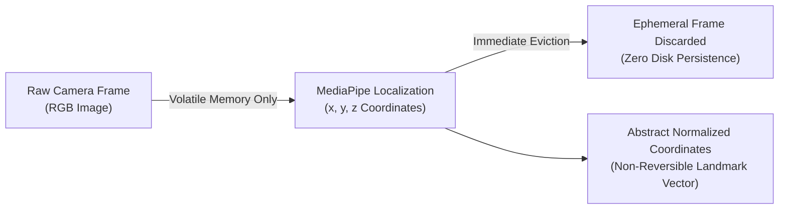

# SANKET (संकेत) — Security, Privacy & Access Governance

> **Biometric Privacy Protection, Access Governance, and Authentication Model**  
> *Authoritative specification of data protection principles, threat modeling, and access controls.*

---

## 1. Authentication Applicability Statement

> [!NOTE]
> **Traditional User Authentication Is Not Applicable**: SANKET is a localized, client-side accessibility system and computer vision pipeline designed for direct edge execution on personal workstations and edge devices. It does not operate a multi-tenant web application, public REST backend, or user account database. Consequently, traditional user credential systems (passwords, JWTs, OAuth2, session cookies) are **intentionally not applicable**.

Instead, SANKET's security architecture centers on **Biometric Data Protection, Dataset Access Governance, and CI/CD Repository Hardening**.

---

## 2. The Zero-Biometric-Retention Security Model

Sign language recognition requires processing visual streams that capture sensitive biometric characteristics (facial features, gaze, bodily morphology). Under international standards (ISO/IEC 27701) and Indian data protection laws (Digital Personal Data Protection Act, 2023), raw biometric media demands the highest level of privacy protection:



### Architectural Controls
1. **Volatile Memory Quarantine**: Live camera frames acquired via `sanket.vision.capture.CameraCapture` reside exclusively in bounded RAM queues (`queue.Queue(maxsize=2)`).
2. **Immediate Eviction**: As soon as landmark coordinates are computed, the underlying NumPy frame buffer is dereferenced and garbage collected.
3. **No Disk Spooling**: At no point does the application write temporary image frames (`.png`, `.jpg`, `.mp4`) to disk or temporary cache folders.
4. **Non-Reversible Coordinates**: Extracted skeletal landmarks represent abstract spatial point coordinates. Generating realistic facial or body imagery from sparse landmark coordinates without generative inversion models is mathematically impossible.

---

## 3. Dataset Licensing & Access Control

To protect intellectual property, subject privacy, and research ethics:
- All external datasets (such as `INCLUDE` or `ISL-CSLTR`) require documented owner-approval before download.
- No third-party dataset archives or media files are ever committed to version control.
- Dataset integrity is verified using cryptographic SHA-256 hashes registered in `docs/datasets/DATASET_REGISTER.md`.

---

## 4. Repository & CI/CD Access Governance

1. **Least-Privilege GitHub Actions Tokens**:
   Workflows in `.github/workflows/` declare minimal permissions:
   ```yaml
   permissions:
     contents: read
   ```
2. **Immutable Action Pinning**:
   All third-party actions are pinned to 40-character commit SHAs rather than mutable branch or semver tags:
   - `actions/checkout@11bd71901bbe5b1630ceea73d27597364c9af683`
   - `actions/setup-python@42375524e23c412d93fb67b49958b491fce71c38`
3. **Human Merge Control**:
   Automated AI tools and contributors are prohibited from independently approving or merging pull requests. Progression is strictly gated by the repository owner.

