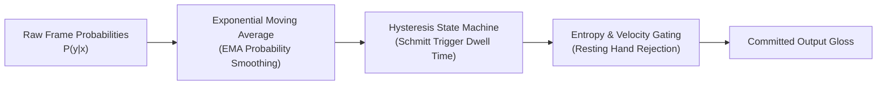

# SANKET (संकेत) — Core Mathematical & Business Logic Specifications

> **Formal Mathematical Formulations, Algorithms, and Domain Logic**  
> *Authoritative specifications for normalization, feature extraction, smoothing, and evaluation.*

---

## 1. Coordinate Normalization Mathematics (ADR-0002)

To achieve scale and translation invariance across different camera distances and signer body sizes, all 3D skeletal landmarks $\mathbf{P} \in \mathbb{R}^{21 \times 3}$ undergo affine normalization:

### 1.1 Translation Invariance (Wrist Centering)
Let $\mathbf{p}_0 = (x_0, y_0, z_0)$ represent the 3D coordinate of the wrist landmark (index 0). The translated keypoints $\mathbf{P}'$ are computed as:

$$\mathbf{p}'_i = \mathbf{p}_i - \mathbf{p}_0 \quad \forall i \in \{0, 1, \dots, 20\}$$

After translation, the wrist keypoint is anchored at the origin: $\mathbf{p}'_0 = (0, 0, 0)$.

### 1.2 Scale Invariance (Palm Sizing)
The physical palm scale $s$ is defined as the Euclidean distance between the wrist (index 0) and the middle finger Metacarpophalangeal (MCP) joint (index 9):

$$s = \|\mathbf{p}_9 - \mathbf{p}_0\|_2 = \sqrt{(x_9 - x_0)^2 + (y_9 - y_0)^2 + (z_9 - z_0)^2}$$

The fully normalized coordinate matrix $\mathbf{P}^*$ is obtained by dividing by scale factor $s$:

$$\mathbf{p}^*_i = \frac{\mathbf{p}'_i}{s + \epsilon} \quad \forall i \in \{0, 1, \dots, 20\}$$

where $\epsilon = 10^{-7}$ prevents division by zero in degenerate detections.

---

## 2. Feature Engineering Mathematics

The composite feature vector concatenates five distinct feature topologies into a 645-dimensional space:

### 2.1 Joint Angles (60 Dimensions)
For adjacent bone vectors $\mathbf{u} = \mathbf{p}_a - \mathbf{p}_b$ and $\mathbf{v} = \mathbf{p}_c - \mathbf{p}_b$ sharing joint $\mathbf{p}_b$, the 3D joint angle $\theta$ is derived via the inner product:

$$\theta = \arccos\left(\frac{\mathbf{u} \cdot \mathbf{v}}{\|\mathbf{u}\|_2 \|\mathbf{v}\|_2 + \epsilon}\right)$$

Angles are computed across 10 anatomical finger joints for both hands projected onto 3 anatomical planes ($xy$, $yz$, $zx$), yielding $10 \times 2 \times 3 = 60$ features.

### 2.2 Pairwise Euclidean Distances (210 Dimensions)
Normalized pairwise Euclidean distances between key anatomical landmarks (fingertips, MCP joints, wrist):

$$d_{ij} = \|\mathbf{p}^*_i - \mathbf{p}^*_j\|_2 = \sqrt{\sum_{k \in \{x, y, z\}} (p^*_{i,k} - p^*_{j,k})^2}$$

Computed across 15 distinct landmark indices per hand, producing $\binom{15}{2} = 105$ distances per hand $\times$ 2 hands $= 210$ features.

### 2.3 Temporal Statistical Moments (123 Dimensions)
Over a sliding window $W = \{t-K, \dots, t\}$ of normalized coordinates:
1. **Temporal Mean**: $\mu_i = \frac{1}{|W|} \sum_{\tau \in W} \mathbf{p}^*_i(\tau)$
2. **Temporal Variance / Std**: $\sigma_i = \sqrt{\frac{1}{|W|} \sum_{\tau \in W} (\mathbf{p}^*_i(\tau) - \mu_i)^2}$
3. **Kinematic Velocity**: $\mathbf{v}_i(t) = \frac{\mathbf{p}^*_i(t) - \mathbf{p}^*_i(t-1)}{\Delta t}$

---

## 3. Real-Time Temporal Smoothing & Gating

Per-frame classifier predictions are stabilized using a three-stage filtering cascade:

### 3.1 Exponential Moving Average (EMA)
The smoothed probability distribution $\mathbf{S}_t \in \mathbb{R}^{C}$ at time $t$ is updated with decay parameter $\alpha = 0.3$:

$$\mathbf{S}_t = \alpha \mathbf{P}_t + (1 - \alpha) \mathbf{S}_{t-1}$$

### 3.2 Schmitt-Trigger Hysteresis State Machine
A sign transition from state $S_A$ to $S_B$ requires:
1. Probability condition: $S_t(B) \ge \theta_{\text{enter}}$ where $\theta_{\text{enter}} = 0.70$.
2. Temporal persistence condition: The condition must hold for at least $N_{\text{dwell}} = 4$ consecutive frames.
3. Exit threshold: State $S_B$ is maintained until its probability drops below $\theta_{\text{exit}} = 0.45$.

### 3.3 Prediction Entropy Gating
To reject out-of-vocabulary gestures, the Shannon entropy $H(S)$ is evaluated:

$$H(S) = - \sum_{c=1}^{C} S_t(c) \log_2(S_t(c) + \epsilon)$$

If $H(S) > H_{\text{threshold}}$ or $\max_c S_t(c) < \theta_{\text{conf}}$, the system gates output to `NO_SIGN` / `IDLE`.

---

## 4. Evaluation Metrics Formulation

As codified in `docs/research/EVALUATION_METHODOLOGY.md`:

- **Macro-Averaged F1**:
  $$\text{Macro } F_1 = \frac{1}{C} \sum_{c=1}^{C} \frac{2 \cdot \text{Precision}_c \cdot \text{Recall}_c}{\text{Precision}_c + \text{Recall}_c}$$

- **Multi-Class Matthews Correlation Coefficient (MCC)**:
  $$\text{MCC} = \frac{c \cdot s - \sum_{k} p_k t_k}{\sqrt{(s^2 - \sum_{k} p_k^2)(s^2 - \sum_{k} t_k^2)}}$$
  where $c$ is total correct samples, $s$ is total samples, $p_k$ is column sums, and $t_k$ is row sums in the confusion matrix.

