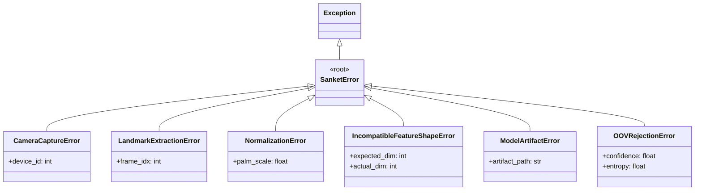

# SANKET (संकेत) — Error Handling & Fault Resilience Architecture

> **Exception Hierarchy, Recovery Strategies, Landmark Imputation, and Fault Tolerance**  
> *Authoritative specifications for handling runtime edge cases and hardware disruptions.*

---

## 1. Exception Hierarchy

SANKET organizes all errors into a structured class hierarchy rooted in `SanketError`:

---

## 2. Failure Modes & Automatic Recovery Protocols

### 2.1 Camera Hardware Disconnection
- **Symptom**: `cv2.VideoCapture.read()` returns `(False, None)`.
- **Handling**:
  1. The acquisition worker logs a warning and marks `is_camera_connected = False`.
  2. Enters an exponential backoff reconnection loop (retrying at 1s, 2s, 4s, up to 10s).
  3. Video display renders a high-contrast warning banner: `CAMERA DISCONNECTED - ATTEMPTING RECONNECT`.
  4. Once re-acquired, clears the frame queue and resumes inference without crashing the application.

### 2.2 Missing Landmark Imputation & Tracking Drop
- **Symptom**: MediaPipe detects only one hand or temporarily loses palm tracking due to rapid motion or occlusion.
- **Handling**:
  1. **Short Drops ($\le 3$ frames)**: Linearly interpolate landmark coordinates from previous valid frames $t-1$ and $t-2$.
  2. **Extended Absence ($> 3$ frames)**: Zero-pad the non-detected hand coordinates. The feature extractor handles zero-padded hands by emitting neutral geometric values rather than `NaN` or `Inf`.
  3. **Zero Division Guard**: Palm scaling enforces $s^* = \max(s, \epsilon)$ where $\epsilon = 10^{-7}$, eliminating divide-by-zero crashes when wrist and MCP overlap.

### 2.3 Model Inference Fallback & Out-of-Vocabulary (OOV) Gating
- **Symptom**: User gestures randomly, transitions between signs, or rests hands on desk.
- **Handling**:
  1. If maximum class probability $\max_c P(y_c|x) < \theta_{\text{conf}}$ (default $0.65$), prediction is gated to `NO_SIGN`.
  2. If prediction Shannon entropy $H(P) > H_{\text{threshold}}$, classification is treated as ambiguous and suppressed.
  3. UI retains previous valid gloss during dwell time rather than rapidly flickering between random classes.

---

## 3. Data Integrity & Validation Checks

- **Config Validation**: Pydantic validates all configuration files on startup; invalid types or negative FPS values trigger explicit schema errors before resource allocation.
- **Model Checkpoint Validation**: Loading a `.joblib` model checks both file existence and validates that the deserialized object is an instance of `BaseSignClassifier`.
- **Dimension Guards**: The feature extractor asserts `feature_vector.shape == (645,)`. If dimensions diverge, an `IncompatibleFeatureShapeError` is raised with detailed dimensional breakdown.

