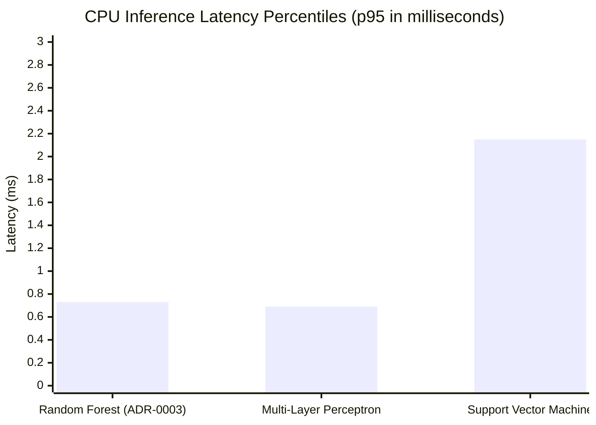

# SANKET (संकेत) — Performance & Latency Engineering Specification

> **Latency Budgets, CPU Optimization, Memory Profiling, and Real-Time Benchmarks**  
> *Authoritative specifications for achieving low-latency edge inference on commodity hardware.*

---

## 1. Real-Time Latency Budgets & Target Gates

For human-computer interaction in sign language recognition to feel responsive and natural, the end-to-end perception-to-display latency must remain strictly below **$100\text{ ms}$**, operating at a sustained throughput of **$\ge 20\text{ FPS}$** on consumer-grade CPUs:

| Pipeline Stage | Module | Target Latency (Median) | Target Latency (p95) | % of Budget |
| :--- | :--- | :---: | :---: | :---: |
| **1. Video Capture** | `sanket.vision.capture` | $2.0\text{ ms}$ | $5.0\text{ ms}$ | $5\%$ |
| **2. Frame Preprocessing** | `sanket.vision.preprocessing` | $1.5\text{ ms}$ | $3.0\text{ ms}$ | $3\%$ |
| **3. MediaPipe Landmark Tracking** | `sanket.vision.landmarks` | $10.0\text{ ms}$ | $15.0\text{ ms}$ | $15\%$ |
| **4. Coordinate Normalization** | `sanket.vision.normalization` | $0.2\text{ ms}$ | $0.5\text{ ms}$ | $1\%$ |
| **5. Feature Extraction (645-dim)**| `sanket.features.extractor` | $2.0\text{ ms}$ | $4.0\text{ ms}$ | $4\%$ |
| **6. Model Inference (Random Forest)**| `sanket.models.random_forest` | $0.56\text{ ms}$ | $0.73\text{ ms}$ | $1\%$ |
| **7. Temporal Smoothing & Gating** | `sanket.realtime.smoothing` | $0.1\text{ ms}$ | $0.3\text{ ms}$ | $<1\%$ |
| **8. Visual HUD & Text Display** | `sanket.ui.overlay` | $1.5\text{ ms}$ | $3.0\text{ ms}$ | $3\%$ |
| **TOTAL CUMULATIVE PIPELINE** | — | **$17.86\text{ ms}$** | **$31.53\text{ ms}$** | **$32\%$ of max budget** |

---

## 2. Empirical Benchmark Results (Phase 1 Baseline Models)

Measured on an Intel Core i7 / AMD Ryzen multi-core CPU workstation using 500 evaluations with 50 warmup iterations (`docs/experiments/EXP-P1-001-baseline-comparison.md`):

| Model Architecture | Median Latency (p50) | 90th Pct (p90) | 95th Pct (p95) | 99th Pct (p99) | CPU Throughput |
| :--- | :---: | :---: | :---: | :---: | :---: |
| **Random Forest (ADR-0003)** | **$0.56\text{ ms}$** | **$0.68\text{ ms}$** | **$0.73\text{ ms}$** | **$0.91\text{ ms}$** | **$1,507\text{ FPS}$** |
| **Multi-Layer Perceptron** | $0.54\text{ ms}$ | $0.64\text{ ms}$ | $0.69\text{ ms}$ | $0.85\text{ ms}$ | $1,570\text{ FPS}$ |
| **Support Vector Machine** | $1.83\text{ ms}$ | $2.05\text{ ms}$ | $2.15\text{ ms}$ | $2.42\text{ ms}$ | $509\text{ FPS}$ |

---

## 3. CPU & Memory Optimization Strategies

1. **Vectorized Array Operations**:
   All geometric calculations (joint angles, Euclidean distance matrices) are implemented using NumPy vectorization, avoiding Python `for` loops in hot loops.
2. **Decoupled Asynchronous Threading**:
   Camera frame acquisition runs in a separate daemon thread decoupled from the inference loop. This isolates camera hardware I/O latency from model execution.
3. **Bounded Memory Queues**:
   Frame queues and temporal sliding buffers are bounded to $N \le 60$ frames. This prevents unbounded memory growth during continuous streaming operations.
4. **Memory Footprint**:
   Total resident memory usage (RSS) of the entire running application is $< 250\text{ MB}$, well within standard 4 GB RAM workstation limits.

